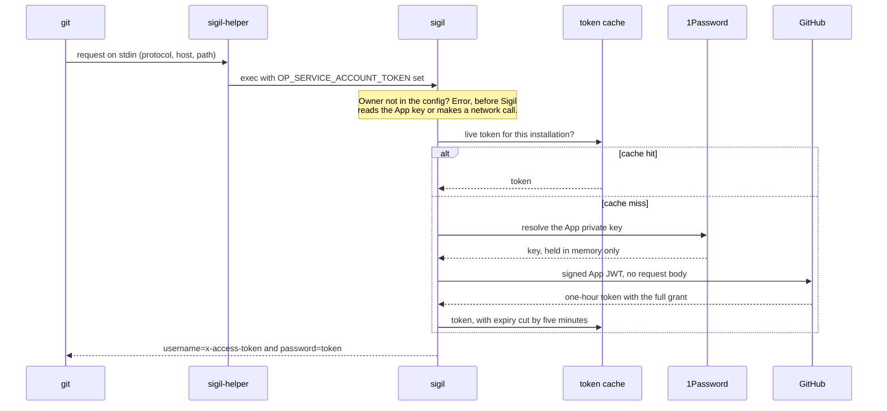
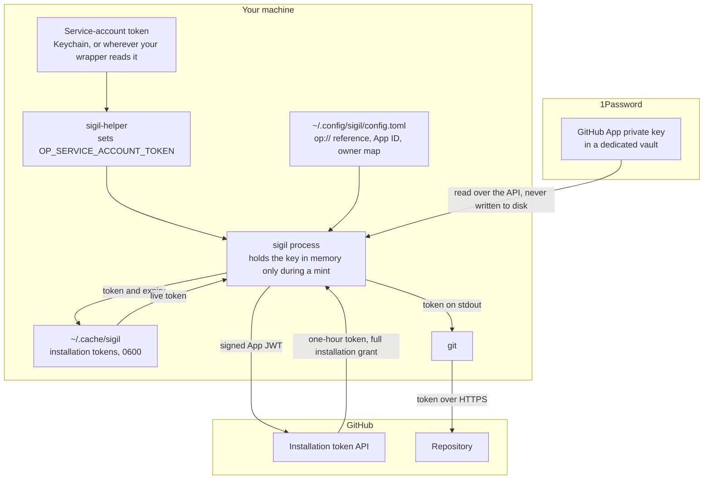

# Sigil

Sigil is a [git credential helper](https://git-scm.com/docs/gitcredentials) for GitHub. When git needs to authenticate to `https://github.com`, Sigil mints a short-lived GitHub App installation token and hands it to git. The App's private key stays in 1Password and Sigil reads it in process through a service account, so it doesn't need the 1Password desktop app, a biometric prompt or the `op` CLI, and nobody has to be at the machine.

You'd want this if you already keep secrets in 1Password and you have git running unattended on a machine you control, like an overnight job or a coding agent working through a long task. You have to have 1Password, but for people using 1Password it works great. I run it across my GitHub projects. If 1Password isn't part of your setup, [these other tools](#other-tools) are where to look.

Git receives the installation's full grant, meaning every permission the App holds on every repository that installation covers, and a cached token carries that for up to about 55 minutes. Narrowing git's token is planned and it isn't done.

## Why I built it

My unattended runs used to push over SSH with a key served by the 1Password SSH agent. That agent suspends when the Mac sleeps and expires when the session times out, which is exactly when an overnight run needs it, and the run would stop with `Permission denied (publickey)`. When I wrote the problem up in June 2026 it was the most common reason those runs halted, on 27 of the previous 30 days. Keeping the machine awake only worked around it.

I wanted a credential a process could use with nobody present, that kept working after the machine slept and didn't put a long-lived GitHub credential on disk. A GitHub App fits because it has two tiers: a private key that stays protected, and installation tokens that expire after an hour. A 1Password service account gets the key to a headless process, because its token authenticates the process with no prompt and doesn't depend on the desktop app. Sigil connects those two to git.

## What it doesn't do

- It only reads the key from 1Password. That's compiled in, and there's no option for a key file or an OS keyring.
- It only answers for HTTPS to `github.com`. Any other host or protocol gets no output, so git moves on to its next helper, and that means GitHub Enterprise Server isn't supported.
- It doesn't keep the credential away from other processes running as you. [What it protects and what it doesn't](#what-it-protects-and-what-it-doesnt) goes through that.
- There's no prebuilt binary and you write a small wrapper yourself, so setup is twelve steps.
- It has only been run on macOS. The only macOS-specific piece is the Keychain call in the wrapper.

### Other tools

None of these need 1Password. The first two are credential helpers, and the other two keep the App key off the machine doing the work:

- [bdellegrazie/git-credential-github-app](https://github.com/bdellegrazie/git-credential-github-app) is a Go binary, configured with one helper line per org in your gitconfig, that reads the App key from a file.
- [AmadeusITGroup/gh-app-auth](https://github.com/AmadeusITGroup/gh-app-auth) is a `gh` extension that routes by URL prefix to several Apps or PATs, keeps tokens in memory only, and takes the key from the OS keyring with a filesystem fallback.
- [openabdev/octobroker](https://github.com/openabdev/octobroker) is a server gateway where agents hold a revocable broker key and it holds the App key.
- [octo-sts/app](https://github.com/octo-sts/app) is a service that swaps an OIDC token from a CI or cloud workload for a GitHub token when a trust policy in the repository matches.

The bdellegrazie and Amadeus helpers both predate Sigil. All four projects move, so check their own docs for what they do today.

## How a request flows

This is the path of a credential request from git, for both a cache hit and a miss.



Git runs the helper with the request on stdin: protocol, host and, because `useHttpPath` is set, the repository path. The wrapper puts the service-account token in the environment and execs `sigil`, and Sigil ignores anything that isn't HTTPS to `github.com`. It then takes the owner from the path and looks up the installation ID in the config. An owner that isn't there is an error, because there's no default installation, and this happens before Sigil reads the App key or makes any network call.

Next is the cache. A live token for this installation goes straight back to git without reading 1Password or calling GitHub, so 1Password reads follow the tokens Sigil mints and not the requests git makes, which matters because [1Password rate-limits service accounts](https://www.1password.dev/service-accounts/rate-limits). A missing or corrupt cache file counts as a miss.

On a miss, Sigil resolves the key from 1Password and signs an RS256 JWT, dated 60 seconds in the past to allow for clock skew and expiring in 10 minutes, which is GitHub's limit. It sends that to `POST /app/installations/{id}/access_tokens` with no request body, which is why the token carries the full grant. A 401 gets exactly one retry with a fresh JWT, for the case where the JWT aged out in flight.

The token is cached with its expiry cut by five minutes, so a cache hit can't hand back a token about to die mid-push, and it goes to stdout as the two lines git expects:

```
username=x-access-token
password=<token>
```

## Where things live

The cached token is the only credential Sigil writes to disk. This is where each piece sits and how they connect.



| Piece | Where it lives | Lifetime | What it can do |
|---|---|---|---|
| App private key | A dedicated 1Password vault, and Sigil's memory during a mint. Sigil never writes it to disk. | Until you rotate it | Mint tokens for every installation of the App |
| Service-account token | Wherever your wrapper reads it from (the macOS Keychain on my machine), then the `sigil` process's environment. The config has no field for it. | Until it expires or you revoke it | Read that one vault |
| Installation token | `~/.cache/sigil`, as one `0600` file per installation in a `0700` directory, and stdout on its way to git | One hour, served from the cache for up to about 55 minutes | Everything the App was granted on that installation |
| Config | `~/.config/sigil/config.toml` | Until you change it | Nothing. It holds an `op://` reference, the App ID and the owner map, and no secrets |

## What it protects and what it doesn't

The design is aimed at leaks. Sigil never writes the App key to disk, so it won't turn up in a backup. An installation token expires within the hour, though until then a leaked one is worth everything it was granted. The one standing secret on the machine is the service-account token, which reads one vault, and you can revoke it without touching the App key. A cached token doesn't need the service-account token, so revoking that doesn't stop Sigil serving a cached token. To cut Sigil off fully, also empty `~/.cache/sigil`, and a token already handed out stays valid at GitHub until it expires, up to an hour.

It doesn't stop something running as your user on the same machine. Any such process can do what git does: write three lines to `sigil-helper` and get a token for any owner in your config. It can also read the cache file, because `0600` only keeps out other users. And if your wrapper reads the service-account token without a prompt, that process can run the same command and read the App key itself. Narrowing git's token would limit what a leaked token can do, and it wouldn't change anything for a process that can ask for another one. Keeping the App key out of reach of your agents takes a separate OS user or host, and the last two under [Other tools](#other-tools) are built around holding it somewhere else.

`sigil token <owner>` prints the same full-grant token directly, and it reads and writes the same cache as git. It refuses a pipe or a file as stdout, and that check is a speed bump. It turns the accidental case into a loud failure before Sigil reads the App key, but it only tests for a character device, so `> /dev/null` passes and still mints and caches a token. A pty walks straight through it too, and the helper path gives the same token to anything that asks over a pipe, as it has to for git to work.

Everything going through one App also shows up on GitHub as one actor, so you can't tell two agents on the same machine apart by who pushed.

A few smaller rules the code holds to:

- Cache permissions are re-applied after every write, because the mode argument is ignored when the file already exists. A cache file holds a token and an expiry and nothing else.
- The API base URL has to be HTTPS, or plain HTTP on loopback for tests, and that's checked before the key is read.
- Error messages don't quote key or token material.

## Why a GitHub App, and why 1Password

I compared a GitHub App against these four options. Classic PATs and plain `gh auth` weren't among them.

| Option | Why I passed |
|---|---|
| Fine-grained PAT | A standing secret, usable for the rest of its life if it leaks, and it acts as me, which muddies attribution |
| Machine user with a fine-grained PAT | Clean attribution, at the cost of a second GitHub account to secure, and the token still stands |
| Per-repo deploy keys | The tightest scope of the lot, but they're git-only and I wanted pull requests through the API too. They also sit on disk in plaintext by default, one per repository |
| Personal SSH key in the 1Password agent | Account-wide scope, and this is the setup that kept halting |

Keeping the App key directly in the Keychain or a `chmod 600` file would also have worked, with fewer moving parts. The hop through 1Password means what sits on the machine is a read-only token for one vault, and I can revoke that without touching the App key. That helps if the token leaks off the machine or the machine is lost, and it adds little against something already running as me.

I use one App for everything on the machine. Per-agent Apps would give each agent its own actor on GitHub and its own revocation, and I gave those up because they'd mean a key, an installation and a rotation per agent, all on one machine that holds every key anyway. A second host running agents would change that answer.

Sigil is in Go where I'd normally default to Rust. When I built it there was no official 1Password SDK for Rust, so Rust would have meant shelling out to `op` and parsing its output, while the official Go SDK reads the key in process. The cost shows up in the supply chain: the SDK is a WASM core, so the tree brings in a WebAssembly runtime, a plugin framework and an OpenTelemetry and protobuf stack, and the binary comes to about 28 MB.

## Setup

You need a 1Password plan with service accounts and Go 1.26.10 or newer.

1. **Register a GitHub App** on your account, with the webhook off. Set its visibility to *Any account* if it has to install anywhere other than the account that owns it, because a private App can only install there. Public controls who can discover and install the App, and it doesn't expose the key. Note the App ID, which isn't a secret.
2. **Set its repository permissions** to what your automation needs and no more. That's what the App is granted, and git gets all of it.
3. **Generate a private key** and download the `.pem`.
4. **Install the App** on each account or org. Each installation ID is in the URL you land on afterwards.
5. **Store the `.pem` in a dedicated 1Password vault**, as a file attachment or multiline text and never as a concealed field. A concealed field strips the PEM's newlines, and what you see later is `no PEM block found`, with nothing pointing at the field type. Delete the local `.pem` afterwards.
6. **Create a read-only service account** scoped to that vault. Service accounts can't read the built-in vaults, which is why it has to be a dedicated one, and vault access can't change after creation, so getting it wrong means recreating the account.
7. **Put the service-account token somewhere your wrapper can read it without a prompt.** I use the macOS Keychain on an encrypted disk. Don't use `launchctl setenv`, which makes it readable process-wide.
8. **Build and install:**

   ```bash
   git clone https://github.com/prmanahan/sigil.git
   cd sigil
   go build -o ~/.local/bin/sigil .
   ```

9. **Write the wrapper** at `~/.local/bin/sigil-helper` and make it executable. Sigil reads the token from `OP_SERVICE_ACCOUNT_TOKEN` and nothing else, so the Keychain here is one way of supplying it and the wrapper is yours to change:

   ```sh
   #!/bin/sh
   OP_SERVICE_ACCOUNT_TOKEN="$(security find-generic-password -s <keychain-item> -w)"
   export OP_SERVICE_ACCOUNT_TOKEN
   exec "$HOME/.local/bin/sigil" "$@"
   ```

   Keep the `"$@"`. Git passes `get`, `store` or `erase` as an argument, and Sigil treats no argument as `get`.

10. **Write the config.** Copy `config.example.toml` to `~/.config/sigil/config.toml` and fill in the `op_key_ref`, the `app_id`, and one line under `[installations]` for each owner.
11. **Register the helper** in your git config:

    ```gitconfig
    [credential "https://github.com"]
        helper =
        helper = !sigil-helper
        useHttpPath = true
    ```

    - **The empty `helper =` is deliberate.** `credential.helper` is a list that git accumulates across system, global and local config, and an empty value resets it. Without that line, whatever was configured earlier stays ahead of Sigil. If that's `gh auth git-credential`, it holds a valid token and answers successfully every time, so git keeps working and Sigil is never consulted.
    - **The `!` makes it a shell command**, so `PATH` applies. Without it git looks for an executable called `git-credential-sigil-helper` and finds nothing. An absolute path works too and needs no `!`.
    - **`useHttpPath = true` makes git send the repository path**, which Sigil needs for routing. Without it every request fails with `repoPath is empty`, an error that never mentions git config.

    The block only fires for HTTPS requests to `github.com`, since SSH remotes never touch git's credential system. It can go in your global config or in one repository's `.git/config`, which is how I wire mine, clone by clone.

12. **Verify.** `sigil-helper doctor` checks the config, that the service-account token is set, the key read and a JWT mint without contacting GitHub. After that, a successful push doesn't prove Sigil served it, because another helper may hold a valid token too. To check, empty `~/.cache/sigil`, push or fetch a private repository, and look for a new file there. A fetch from a public repository won't do, because git only asks for a credential when GitHub challenges it.

### Optional: a second remote for your own pushes

GitHub records a push against the credential that made it, so pushes through Sigil are recorded as the App. To keep some pushes under your own name, add a second remote over SSH with `git remote add ssh_origin git@github.com:<owner>/<repo>.git` and push to it by name, since SSH uses your own key and never consults git's credential system. Don't combine this with a `url.<base>.insteadOf` rewrite of `git@github.com:` to HTTPS, because `insteadOf` applies to remote names too and would send those pushes through Sigil as the App.

## Commands

Anything that reads the key needs `OP_SERVICE_ACCOUNT_TOKEN` in the environment, so run these through the wrapper.

| Command | What it does |
|---|---|
| `sigil-helper` or `sigil-helper get` | The credential-helper path. Reads a request on stdin and writes credentials to stdout |
| `sigil-helper token <owner>` | Prints a full-permission installation token for that owner, cached. Refuses a pipe or a file as stdout, though `> /dev/null` passes and still mints and caches |
| `sigil-helper token --rate-limit-only <owner>/<repo>` | Prints a token with `metadata:read` on exactly one public repository, which is enough to raise the REST rate limit and nothing else. GitHub's grant is verified first, and a mismatch revokes the token and errors. A private repository counts as a mismatch. Never cached, and it runs unattended |
| `sigil-helper doctor` | Checks the config, that the service-account token is set, the key read and a JWT mint without contacting GitHub. Prints the App ID, counts and sizes, and never key or token material |
| `sigil-helper store` or `erase` | No-ops, because git expects them to exist |

`--rate-limit-only` is the one form that checks what GitHub granted, because a grant can differ from the request. In a live run against the API, an empty `permissions` object was granted every permission the installation held, write included, and an empty `repositories` list came back as `repository_selection: all`. So this form compares the response with what it asked for before it prints anything. Git's path asks for nothing narrower, so it has nothing to compare.

Any subcommand Sigil doesn't recognise, `--help` included, falls through to the credential-helper path and blocks reading stdin. There's no help output.

## Development

```
just check     # go vet, gofmt check, tests
just test      # tests only
just build     # writes ./sigil
```

The tests use Go's `testing` package with no assertion library, and `jwt_test.go` also uses `golang-jwt`. GitHub is mocked with `httptest` and RSA keypairs are generated in process. Two tests skip unless both `OP_SERVICE_ACCOUNT_TOKEN` and `SIGIL_TEST_OP_KEY_REF` are set, and they're the end-to-end path and the whole-binary check that a token doesn't reach stderr. The tests that allocate a pty also skip off macOS. The default run does check stderr on `sigil get`'s cache-hit path through the real binary, and on the one function that writes credentials, but a run without real 1Password credentials hasn't exercised a live mint. There's no CI in this repository, so the gate is `just check` plus an optional pre-commit secret scan. `just hooks` installs a copy of that scan, which needs `gitleaks` on your `PATH`, into your clone. It covers `git commit` only, `--no-verify` skips it, and it's a convenience, not a boundary. `just secret-scan` runs the full history and tree scan by hand.

## License

Apache-2.0. See [`LICENSE`](LICENSE).
