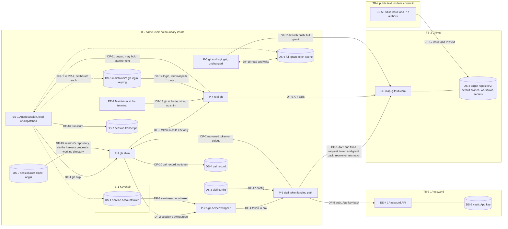

# Frame: Narrowed GitHub token for lead sessions' `gh` work

**Date:** 2026-11-09
**Status:** locked (2026-11-19)
**Intake:** `docs/intent/lead-session-gh-token.md`

Evidence labels: **[measured]** read or run in this Frame's authoring session; **[inherited]** from the lead, an earlier read or a document, not re-checked here; **[quoted]** from vendor documentation, as relayed by the lead; **[inferred]** reasoned, with what it rests on; **[estimate]** arithmetic on stated assumptions. Identifiers local to this document: `FD-n` locked decision, `QA-n` quality-attribute scenario, `LT-n` check at the first live run, `RR-n` residual route, `DEF-n` deferral, `ED-n` decision for the maintainer, `RISK-x` above-bar risk, accepted or deferred, with its register id.

## Stage 2a — Elicitation

Modulation: cold-start. No earlier Frame exists in this repository, and the work changes the authentication surface.

The maintainer's direction, verbatim:

- Token refresh: "we'll start with every gh call, but there could be multiple lanes open using sigil. i've had up to 6 at once and if they run all day and into the night we might hit limits. But we can start there and measure". Reading: a fresh mint per `gh` call, no cache, and mint volume is measured. Everything here runs with him away.
- Secret detection floor: "Add the check now". A separate change adds a pre-commit `gitleaks` hook and recipe.
- The floor item "a secret, once read, never goes to disk": "Only secrets from a store". It governs the App key and the service-account token. Short-lived minted tokens in `0600` files on an encrypted disk are allowed.
- Layering: "my github login will be off once this works in gh" and "until i sandbox agents then that will remove the final step". Revoking the login follows this feature and is not part of done. Sandboxing is his own future control against a misdriven session.
- Repository pinning, 2026-11-11. His goal, restated: "the problem was allowing unattended runs to allow merges and PR creation to gitub from the repo they are running in without me. Doing that in a secure way." Then: "ie with least privledge where possible." To the lead's question, quoted in the lead's words, "Should the landing token be pinned to the session's own repo (its clone's origin)? Pinning means: amend the design doc and its intake's not-to-build list, then one more review round before the gate." he chose "Pin to own repo (Recommended)". Reading: the routine `gh` path mints only for the session's repository (`FD-7`), and the intake's Terms, Non-goal 8 and not-to-build list are amended to match.

One local credential check, reported by outcome: closed on his statement (`ED-3`).

The lead's proposed shape, put to this stage for confirmation or replacement: a small `gh` shim on a lead session's `PATH` that resolves the repository (since the 2026-11-11 ruling, the session's repository, `FD-7`), mints per call through a new fixed-permission, non-terminal-safe sigil token path, and runs the real `gh` with the token in that child's environment only and a `gh` config holding no login. Confirmed, with delivery specified (`FD-6`).

## Data flow diagram

| Boundary | Sides | Trust | Crossing flows |
|---|---|---|---|
| TB-0 same user | every local process and store | none; drawn so nobody assumes one | none |
| TB-1 Keychain | DS-1 / P-2 and anything else calling `security` | keys on the calling binary, inferred to admit any caller of `security` [inherited] | DF-3 |
| TB-2 GitHub | host / EE-3, DS-8 | host trusts the response over TLS; GitHub enforces the token's scope | DF-6, DF-9, DF-15 |
| TB-3 1Password | host / EE-4, DS-2 | host holds a read-only token [inherited: the deployment's evidence, recorded privately, `FL-5`] | DF-5 |
| TB-4 public text | EE-5 / DS-8, then agents via DF-11 | none; steering of an agent is not assessed by any lens here | DF-12 |

## Operating constraints

- **OC-1** Scope to the job, short-lived, revocable.
- **OC-2** The shim and the verifier are controls and fail closed in any language.
- **OC-3** A guarantee is carried by a loud mechanism.
- **OC-4** Instrument before the first real run; this beats deferral for a production surface.
- **OC-5** Mechanism waits for evidence, and a deferral names what fires it.
- **OC-6** The change lands behind one seam, with duplication preferred until the third occurrence.
- **OC-7** Test seams at true system boundaries, decided at design time.
- **OC-8** Logs leak secrets if untreated.
- **OC-9** A rejected option stays on the page.
- **OC-10** Layer count against the smallest mechanism.

## Rationale chain

**Intent to constraints.** The job is that routine landing work runs on a credential good for the session's own repository and one job, with nobody present (intake JTBD). A credential is the authority surface (OC-1); a shim standing between a session and a login is a control (OC-2); unattended means failure and volume have to report themselves (OC-3, OC-4).

### Quality-attribute scenarios

| ID | Stimulus | Environment | Response | Measure |
|---|---|---|---|---|
| QA-1 Leak bound | A routine `gh` credential is copied into a log or transcript | Unattended lead session | The copy reaches the session's repository only, with the fixed permissions | GitHub refuses a write to a second covered repository (S3); GitHub's stated expiry is one hour |
| QA-2 Fail closed | No valid token: mint fails, empty output, invalid token, or the session's repository cannot be read | Wired session, his real login in place | `gh` work stops with a visible error | In every seeded state (S7), as `LT-5` runs them and as `LT-10`(5) runs the unreadable-repository state, `gh api user --jq .type` through the shim does not print `User`, while the real binary, run directly, does |
| QA-3 Grant drift | GitHub's response differs from the expected grant in any field | Any mint | Token revoked, nothing emitted, non-zero exit | Fails the gate test on any differing field (S2) |
| QA-4 Mint volume | Six lanes run all day and into the night | Unattended, one 1Password account | Usage is counted, and a warning appears before the limit | Warning fires at the threshold in `FD-9`; local count and 1Password's reported usage are comparable |
| QA-5 Terminal unchanged | He runs `gh` at his own terminal | Feature deployed, login in place | `gh` acts as him | `gh` resolves to the real binary there, and S4's terminal clause passes |
| QA-6 Expiry | A session outlives one token | Session past one hour | Next `gh` call has a fresh token | S6; only a single call running past one hour can expire, and it fails visibly |
| QA-7 Reversal | The feature misbehaves | Deployed | Remove the wiring line and shim; prior binary stays on hand | Session `gh` resolves to the real binary again; prior binary kept until the live criteria pass (intake) |
| QA-8 Pin | A routine `gh` call names another repository (an API path, `GH_REPO`, `-R`) or is made from another repository's clone | Wired session, unattended, misdriven or steered | The token is minted for the session's repository only; a write to the other repository fails visibly at GitHub; no call goes out on his login | In `LT-10`'s seeded cases each form of the same ref creation succeeds on the session's repository and fails with GitHub's HTTP 403 or 404 against repository B, once `FD-11`'s pre-check that B is covered is recorded, and B's non-empty ref list holds none of the attempted refs afterwards; `-R`, which no ref creation takes, is covered by `FD-7`'s gate test that the helper receives the session's repository |

### Locked decisions

**FD-1 New mint path: `sigil token --landing <owner>/<repo>`.** A third enumerated form in `main.go#dispatchToken`, exact-string matched like `--rate-limit-only`. Permitted on a non-terminal stdout. Routing before key read, as on the rate-limit path. Emits the token on stdout only; never reads or writes `cache.go`. The permission set is a fixed constant with no caller input beyond the one repository. Lives as sibling functions, not a parameterised `exchangeNarrowedToken` or `verifyNarrowedGrant`, because S8 fixes that path's behaviour and tests, and this is the second occurrence. *Anchors: P-LeastAuthority, "scope a credential to the operations its role performs and no more"; P-MinBlastRadius, "extract an abstraction on the third occurrence".*
Observable: an argument beginning with `-` that is not one of the two exact flags is refused before any config load; `sigil token <owner>` still takes any other single argument as an owner; existing `--rate-limit-only` tests pass unmodified.
Rejected: a `--permissions` flag (caller-chosen authority; intake's not-to-build list). Widening `verifyNarrowedGrant` with a private-repository option (a single mistaken argument would loosen the rate-limit path, and S8 forbids changing it). Serving a narrowed token from `sigil get` (Non-goal 4, S8).

**FD-2 Expected grant, as a candidate.** Requested explicitly and expected exactly: `contents: write`, `pull_requests: write`, `checks: read`, `workflows: write`, `metadata: read`; `repository_selection: selected`; one repository. `metadata: read` is requested rather than left for GitHub to add, so the request equals the expected response and no rule for an implicit addition is needed; the existing path shows an explicit `metadata: read` request is accepted [measured from `token_narrow.go` and its recorded live run, inherited for the run]. **This set is a candidate and is not yet proven by trial** (`ED-1`, `LT-1` to `LT-3`). *Anchors: P-LeastAuthority, as FD-1; the hard constraint that each permission is included only for a landing step shown by trial to need it.*

| Landing step | How the step names its repository on the command line (the shim does not read it, `FD-7`) | Candidate permission | Basis |
|---|---|---|---|
| `gh repo view <o/r> --json defaultBranchRef` | positional | `metadata: read` | inferred; may be GraphQL |
| `gh repo view <o/r> --json squashMergeAllowed,...` | positional | `metadata: read` | unverified; no source found, may be GraphQL |
| `gh api repos/<o/r>/rulesets`, then each by id | API path | `metadata: read` | GitHub's permissions page [inherited]; the landing procedure warns a 403 may mean a missing admin scope, a conflict `LT-2` settles |
| `gh repo view <o/r> --json visibility` | positional | `metadata: read` | inferred |
| `gh pr view <branch> -R <o/r>` | flag | `pull_requests: read`, within write | [inherited] |
| `gh pr create -R <o/r>` | flag | `pull_requests: write` | [inherited] |
| read checks before merging, `-R <o/r>` | flag | `checks: read` | [inherited]; see `LT-4` |
| `gh pr merge -R <o/r> --rebase --match-head-commit <sha>` | flag | `contents: write` [inherited]; `workflows: write` when the PR changes a workflow, required by S5 | inferred for merge; GitHub documents it for contents and ref writes [inherited] |
| delete the branch, `gh api -X DELETE repos/<o/r>/git/refs/heads/<b>` | API path | `contents: write` | [inherited]; the landing procedure read here has no remote delete, the intake's Landing work does |

Observable: `LT-1` compares GitHub's raw response with this constant, field by field.

Excluded: `issues` and `actions` (no landing step); `statuses` (the App does not hold it [inherited, live read 2026-11-09], and adding it breaks Non-goal 5); Dependabot alerts (the App does not hold it, and no step in the landing procedure uses it [measured from that procedure]).
Rejected: omitting `workflows: write` in favour of a separate credential; S5 and the landing constraint require a workflow change to land by this token.

**FD-3 Verification is exact-match, private repositories allowed on this path only.** A new verifier requires: permission map equal to `FD-2`'s constant in both directions; `repository_selection` equal to `selected`; exactly one repository; name equal. It has no public-repository condition. Empty token and any mismatch follow the existing revoke-and-error handling, including the error that says a revoke failed. *Anchors: P-SecurityLayered, "a control that errors denies".*
Observable: S2's cases, gate-tested for public and private responses.
Limit, stated so it is not over-read: exact-match catches GitHub granting something other than the request. It cannot catch an unneeded permission in the constant itself, since request equals response. That is `ED-1`.

**FD-4 The shim has no route to the login.** A POSIX shell script, tracked in this repository, named `gh`. It:

- resolves the session's repository (`FD-7`), or exits non-zero without minting;
- refuses `gh auth` subcommands and `gh extension` subcommands, including its aliases `gh extensions` and `gh ext`, without minting;
- obtains a token through `sigil-helper token --landing`; on a non-zero exit, or output that is not exactly one non-empty line, exits non-zero without running `gh`, even if a token was printed;
- replaces any inherited `GH_TOKEN`, removes `GITHUB_TOKEN`, `GH_HOST`, `GH_ENTERPRISE_TOKEN` and `GITHUB_ENTERPRISE_TOKEN`, and sets `GH_CONFIG_DIR` to a dedicated directory holding no login and `XDG_DATA_HOME` to a dedicated data directory (`FD-5`), unconditionally, overwriting any inherited value;
- starts the real `gh` by absolute path, with the token passed by environment assignment on `exec`, never on argv and never printed, and with prompts disabled. The trap to avoid: `env GH_TOKEN=... gh` puts the token on `env`'s argv, where `ps` shows it;
- if the install-time path is unset or not executable, exits non-zero without minting.

The service-account token never enters `gh`'s environment, because the wrapper is a separate child [measured from the wrapper text]. *Anchors: P-SecurityLayered, "a control that errors denies rather than passes through"; P-TestableByDesign, double only at a true system boundary.*

Testing seam: the real `gh` path is an injectable value, set at install outside the script's bytes; `sigil-helper` is found on `PATH`, so a fake one can stand in. Go tests under `just check` run the tracked script unmodified, never a copy with the path substituted, with the override read from the environment (an argument would collide with `gh`'s own flags, because the shim forwards `"$@"`), a fake helper and a fake `gh` that records its environment and argv; the live seeded states are S7. The session's repository is read through the process the harness names (`FD-7`), so a test names a process it started in a fixture clone; no override variable is added for it. The override is not a new bypass: it changes which binary receives a narrowed token, and any process of this user can already run the real binary (`RR-1`) or ask for that token (`RR-7`). For a session that can only run `gh`, it does add possession of that token by a binary the session names (`KG-9`).

Observable: each of these, against the recording fake `gh`:

- with a good fake helper, the fake `gh` is invoked and receives `GH_TOKEN` exactly equal to the helper's output, and the dedicated `GH_CONFIG_DIR` and `XDG_DATA_HOME` (the positive control);
- pre-seeded `GH_TOKEN` and `GITHUB_TOKEN` do not reach it, nor do pre-seeded `GH_HOST`, `GH_ENTERPRISE_TOKEN` or `GITHUB_ENTERPRISE_TOKEN`; a pre-seeded `GH_CONFIG_DIR` or `XDG_DATA_HOME` is overwritten, and the fake `gh` records the dedicated value; the recorded `XDG_DATA_HOME` is non-empty and equal to the dedicated value the Spec fixes, and differs from the seed, from `$HOME/.local/share` and from `$HOME/.local/share/gh`, each comparison made after path cleaning, so a trailing slash does not make two paths differ;
- the token appears in neither the fake `gh`'s argv nor the fake helper's. That assertion cannot see the `env` trap, because `env` strips the assignment before it runs `gh`, so a static check over the tracked script's text also runs: it finds no `env` invocation, bare or by path, and allows the token variable only in its capture, a `case` statement for its validity check, and the assignment that hands it to `gh`, so it is never an argument to an external command. The check is shown failing on a seeded `exec env GH_TOKEN=...` line;
- with a helper that exits non-zero, prints nothing, prints a token then exits non-zero, or prints other than one non-empty line, the fake `gh` is not invoked and the shim exits non-zero;
- `gh auth setup-git`, a named case of the `gh auth` refusal, exits non-zero with no mint and the fake `gh` not invoked;
- `gh extension install o/r`, `gh extensions` and `gh ext`, named cases of the `gh extension` refusal, do the same;
- with the install-time path unset or not executable, the shim exits non-zero with no mint.

`gh auth` is refused because `gh auth token --user` and `gh auth logout` read or change the login directly, and because `gh auth setup-git` configures git to use `gh` as its credential helper (per GitHub CLI's documentation, with `gh`'s source showing a `--global` write; not run here), a change outside the dedicated directory, which `FD-5` therefore does not cover, and one that decides which helper answers in any clone without a local helper reset (`RR-2`). This stops ACTOR-1's misdriven path only, since a deliberate caller uses the real binary (`RR-1`). `gh extension` is refused because an installed extension persists in the shared dedicated data directory (`FD-5`) and runs with the token in later calls (`KG-8`). Both refusals cover the single-command misdriven case only: an adaptive session gets past either with one alias, since a non-shell alias such as `gh alias set x 'extension install o/r'`, which `gh` accepts, expands inside `gh` after the shim has seen only `x` (read from `gh`'s help and v2.103.3 source; not run). The data directory bounds where such an extension lands (`FD-5`, `LT-9`); it does nothing for an alias to `auth setup-git`, whose global git write stands. Refusing `gh alias` as well is rejected: each refusal has a successor, and a same-user write to the alias file does the same. The host and enterprise-token variables are removed because `gh` uses an enterprise token, not the minted one, for a host other than `github.com` (per `gh help environment`); removing them stops the same misdriven path from running a wired call on a credential the record would call `narrowed`.

**FD-5 `gh`'s precedence, and how S7 fails closed: two independent layers.** `FD-4` never starts the real `gh` without a minted token. Separately, the shim sets `GH_CONFIG_DIR` to a dedicated directory holding no login, so a `gh` started without a token by a shim defect still refuses. *Anchors: P-SecurityLayered, "each layer is independently load-bearing"; OC-10, Security over Simplicity by default; the maintainer's "we have a layered approach".*

Measured on `gh` 2.103.3, with his login in place, printing only the account type or the first error line, over `gh api user --jq .type` and one `gh repo view`:

| Config | `GH_TOKEN` | Result |
|---|---|---|
| default | unset | prints `User`, exit 0 (positive control) |
| missing directory, no login | empty | `gh auth login` prompt text, exit 4 |
| missing directory, no login, `gh repo view` | unset | same, exit 4 |
| missing directory, no login | invalid, non-empty | API error, exit 1 |
| default | invalid, non-empty | API error, exit 1 |

So a no-login config does keep `gh` off his keyring on these commands, and a non-empty invalid `GH_TOKEN` does not fall back. Other subcommands were not run. `LT-5` repeats this through the shim.

The shim's dedicated data directory keeps extensions reached through it apart from the ones his terminal loads. Extension loading follows `XDG_DATA_HOME`, from `$XDG_DATA_HOME/gh/extensions` [measured by hand on `gh` 2.103.3, not by `LT-9`: an extension seeded under it ran as `gh probe` with `GH_TOKEN` in its environment and was listed; with the variable at an empty directory, `gh probe` failed `unknown command`]. That `gh extension install` writes to the same path is read from source, with partial evidence [measured by hand, same version, not by `LT-9`: a local `gh extension install .` under a redirected directory landed there as a symlink, `$HOME/.local/share/gh` stayed absent, and the extension was unknown without the variable; a remote install was not run]. The route of an extension installed through the shim and then running at his terminal on his login needs two things: the install lands in the dedicated directory, and his terminal does not load from it. Its state is fix specified, verification pending: the loading half and a local install are measured by hand, and a remote install, the form `FD-4`'s refusal names and a steered session would use, is not run. `LT-9` verifies two of the three, the loading half and a local-directory install, and the route returns to `RISK-B` if `LT-9` fails; `FD-11` holds the run with nobody present on that result. The remote install is not verified by any check: the maintainer's 2026-11-11 ruling on `ED-5` dropped it from `LT-9`, so that a remote install lands under `XDG_DATA_HOME` rests on the source reading above alone [inferred, not run]. Review flag Cerberus round 4, F4, stays open on this route until `LT-9` has a recorded pass, and a pass of the local-directory `LT-9` closes it, the remote install covered by the same directory [inferred, untested], on the basis `RISK-B` and `KG-8` state. Only `gh copilot`'s download directory moves with it (`DataDir()` callers in non-test Go at `gh` v2.103.3 and go-gh v2.17.0: the extension manager and `gh copilot`). A session writing into his default data directory directly is same-user file access, the `RR-6` class.
Rejected: no config directory, relying on `FD-4` alone. The directory is one variable, and the measurement shows it works as an independent backstop.
Observable: in `LT-5`'s seeded states, `gh api user --jq .type` through the shim never prints `User`.

**FD-6 Delivery: a dedicated shim directory, on `PATH` in agent sessions only. Locked pending `LT-6`, with the alternative named below.** The shim directory holds nothing but `gh`. The last `PATH` change in `~/.zshrc` prepends it when `CLAUDECODE` is non-empty. At his terminal the marker is absent, so the directory is not on `PATH` and nothing changes. *Anchors: P-GuaranteeByMechanism, the marker is set by the harness and not recalled by anyone; P-LeastAuthority, the change reaches only the sessions it is for.*

Evidence, from one dispatched agent's Bash call [measured unless labelled]:

- The shell is `zsh -c`, a child of the harness, and sources a per-session snapshot file before the command. The snapshot ends by exporting a complete `PATH`, so `PATH` is fixed when the snapshot is taken, and `~/.zshenv` runs too early to matter.
- The snapshot's `PATH` order matches the prepends in `~/.zshrc` and `~/.zprofile`, so those files shaped it [inferred].
- The snapshot was written 12 seconds after the harness process started. So a line added mid-session reaches only sessions started later [inferred].
- `CLAUDECODE=1` is set in the Bash call, with no tty on stdin, stdout or stderr.
- **Not measured:** whether `CLAUDECODE` is set in the shell that builds the snapshot. It does not appear in the harness process's initial environment, which leaves the question open rather than answering it; if it is unset there, the line silently does nothing. `LT-6` decides.
- The marker is absent at his terminal [inferred; `LT-6` and S4 check it].

The claim is scoped: the wiring reaches every Bash-tool call whose shell sources a snapshot built with the marker set. That covers dispatched agents, subject to `LT-6`. Other spawn paths are not measured and are listed in `KG-1`.
Observable: `command -v gh` prints the shim path in a lead session and in a dispatched agent, both started after the line is added, and the real path at his terminal.
Alternative if `LT-6` fails: a harness `SessionStart` hook setting the session's `PATH`, with this Frame revised before the Spec builds on it.
Rejected: placing the shim in `~/.local/bin` with a branch inside for the human case. Any branch to the keyring inside the shim is a fail-open path, and it shadows `gh` at his terminal. A launch-time environment variable (does not survive [inherited]). `~/.zshenv` (overwritten by the snapshot's `PATH`).

**FD-7 Repository: the session's repository, never one the call names. Locked pending `LT-10`, with the fallback named below.** The shim mints for one repository, the session's repository (intake Terms): the `owner/repo` of the `origin` of the git clone at the session's project directory. That directory is the working directory of the harness process the session's commands run under, found through the process id the harness exports to them (`CLAUDE_PID`).

- **The clone** is established first, by a separate check that succeeds only inside a git work tree, such as `git rev-parse --show-toplevel` run in that directory. If that check fails, the result is `no-repo`. The clone is the one that encloses that directory, which may be a parent of it. A directory inside a clone belongs to that clone's project: D-ProjectIsARepo, "the directory holding the `.git` is the project".
- **The `origin`** is then read in that clone with `git config --local --get remote.origin.url`. That gives the clone's own configured value, not a value from the user's global or system configuration, the environment or the command line. It is also not the URL after any `url.<base>.insteadOf` rewrite.
- **Git's environment is removed for both reads.** The shim runs both with every environment variable whose name begins `GIT_` removed.
  - The prefix is removed, rather than a named list, so that a variable added in a later git release is removed too.
  - The variables this covers today: `GIT_DIR`, `GIT_WORK_TREE`, `GIT_COMMON_DIR`, `GIT_CEILING_DIRECTORIES` and `GIT_DISCOVERY_ACROSS_FILESYSTEM`, which redirect or limit how the clone is found; `GIT_CONFIG`, `GIT_CONFIG_GLOBAL`, `GIT_CONFIG_SYSTEM`, `GIT_CONFIG_NOSYSTEM`, and `GIT_CONFIG_COUNT` with `GIT_CONFIG_KEY_<n>` and `GIT_CONFIG_VALUE_<n>`, which redirect or inject configuration; and `GIT_CONFIG_PARAMETERS`, which carries `git -c` values and is not in git's help.
  - The documented names were read from `git help config` and `git help git`, git 2.54.0 [measured 2026-11-11].
  - The `gh` the shim then starts gets the environment `FD-4` sets, unchanged by this.

  *Anchor: P-SecurityLayered, "a control that errors denies rather than passes through".* Without this, an injected value both re-points the pin and turns "not inside a git clone" into a resolved repository. The measurements below, from git 2.54.0, used a value of `https://github.com/other/other` injected into a throwaway non-clone directory and into this clone:
  - `GIT_CONFIG_COUNT=1` with `GIT_CONFIG_KEY_0=remote.origin.url`: a plain `git config --get` in the non-clone directory returns the injected value with exit 0. With `--local` it exits 128, "can only be used inside a git repository". In this clone, `--local` returns the clone's own value despite the same injection.
  - `GIT_CONFIG_PARAMETERS` carrying the same value: a plain `--get` in the non-clone directory also returns it.
  - `GIT_DIR` pointing at this clone: `--local` in the non-clone directory returns this clone's value. So `--local` alone is not enough, and the environment must be removed as well.
- **Its form:** the `origin` must be `https://github.com/<owner>/<repo>` after stripping one trailing `.git`.
- **The resulting `owner/repo`** is accepted only as one whole string, under three conditions:
  - each half matches `[A-Za-z0-9_.][A-Za-z0-9_.-]*`, so neither half begins with `-`;
  - neither half is `.` or `..`;
  - the value contains no newline or carriage return. The value is matched as a whole, never line by line; a line-by-line match such as `grep`'s passes a two-line value with one valid line.

  So a newline cannot forge a record line, a leading `-` cannot be read as a flag, and a dot component cannot name a path.
- **Letter case:** an `origin` whose case differs from GitHub's name for the repository is minted for as written. `FD-3`'s exact name match then refuses and revokes the token, which is a loud failure, fixed by correcting the `origin`. `FD-3` is not loosened for this, since S2 refuses a response that differs "in any respect".

**How the harness process is read.**

- `CLAUDE_PID` must match `^[0-9]+$`.
- Its working directory is read by a reader found on `PATH`, as `sigil-helper` is (`FD-4`). The reader must yield exactly one line holding a non-empty absolute path.
- The shim never passes an empty or relative path to `git -C` or `cd`. `git -C ""` runs in the call's own directory, which is the per-call resolution rejected below.

**When it refuses.** In each of these cases the shim exits non-zero without minting, starts no `gh`, and records `no-repo`:

- `CLAUDE_PID` is unset, does not match `^[0-9]+$`, or names no running process;
- the reader is absent, exits non-zero, or yields nothing, more than one line, or a path that is not absolute;
- the separate check finds that directory is not inside a git work tree;
- the clone has no `origin`, or has an SSH or any other `origin`;
- the value fails the check above.

An SSH `origin` refusing is the hard constraint on https. *Anchors: D-ProjectIsARepo, "the project a session belongs to is derivable from `cwd`, not declared", and "a session is rooted in the project it is working on, and that rooting is the whole of the answer"; P-LeastAuthority, "scope a credential to the operations its role performs and no more"; the maintainer's 2026-11-11 ruling (2a).*

The shim reads no repository from the call: not `-R` or `--repo`, an API path, a positional, a URL, `GH_REPO`, or the call's own working directory. It passes the call's argv and environment to `gh` unchanged apart from `FD-4`'s list. A call aimed at another repository therefore runs on the session's repository's token, and GitHub refuses whatever that token does not reach: every write outside the session's repository, and every read of another private repository. A public repository's data stays readable on the App's identity. [inferred from the token's verified one-repository scope; `LT-10` measures the write refusal on a covered repository, and a repository outside the installation is not run.]

**Where the pin is enforced.** In two places, both already present: the shim's choice of what to mint, and the token's one-repository scope at GitHub, which `FD-3` verifies exactly on every mint. Not in `sigil token --landing`. sigil stays a mint for the repository its caller names (`FD-1`), and S8 keeps it free of harness inputs. The only actor that reaches it without the shim is a deliberate ACTOR-1, and a check in sigil that read the same harness inputs would not stop that actor. *Anchor: P-SecurityLayered, "a layer whose marginal cost ... exceeds its marginal risk reduction is not added".*

**What the pin bounds, stated so it is not over-read.** It stops ACTOR-1 on the routine path, misdriven or steered by ACTOR-3, from landing in another repository with one `gh` command: an API path or `GH_REPO` naming it, `-R`, or a `gh` call made after changing into its clone. It does not stop a deliberate ACTOR-1. Running `sigil-helper token --landing <other>` directly, changing `CLAUDE_PID`, or editing the session clone's `origin` each yields a narrowed token for any covered repository (`RR-7`). **It does not bound the branch push.** Git pushes through `sigil get`, unpinned and with the installation's full grant (Non-goal 4, `RR-4`). Confirmed 2026-11-11 by the lead at decision level 4, with the maintainer informed: the push outside the pin is Non-goal 4, and it is closed by the follow-on work on the credential helper's grant, not by this work.

- **No change of directory and no second clone is needed.** In the session's own clone the local git config registers `sigil-helper` for `https://github.com` with `useHttpPath` [measured 2026-11-11, `git config --local`]. `sigil get` routes on the first path segment only [`CLAUDE.md`].
- **So one ordinary command reaches another repository.** `git push https://github.com/<other-owner>/<other-repo>.git HEAD:<branch>`, run from that clone, gets a full-grant token for any repository the installation covers. It can push any branch to it, workflow files included.
- **On a default branch that nothing protects, that push is a merge without a pull request.**
- **The closing work** is narrowing the credential helper's grant. It is parked, human-noticed: tracked as follow-on work under the overall effort.
  - **When it is read:** whenever the maintainer revokes his `gh` login from sessions. That step already re-decides `RISK-A` (intake, Risk profile), and it is the point at which `sigil get`'s full grant becomes the highest authority left in a session. One event therefore resurfaces both. *V-Consistency.*
  - When that work pins git, it uses this decision's definition of the session's repository.

**A session that needs a second repository** gets GitHub's refusal on the write, shown as `gh`'s non-zero exit. It never gets a fallback to his login (`FD-4`, `FD-5`). That work belongs to a session started in the second repository's clone. *Anchors: D-ProjectIsARepo, "one session per project, rooted in that project" and "cross-project work becomes a filed task"; P-LeastAuthority, "the cue is a task you cannot complete within the authority you hold. That is raised with what it blocked, never solved by taking more."*

Evidence [measured 2026-11-11, from one dispatched agent's Bash call, unless labelled]:

- The call's shell is a direct child of the harness process, and `CLAUDE_PID` equals that process's id.
- That process's working directory is inside the clone the session was started in. In the measured case it is the root.
- After a `cd /tmp` inside the same Bash call, that process's working directory still reads as the root (`lsof -a -p "$CLAUDE_PID" -d cwd`). So a `cd` in a command does not move it.
- [inherited, round-8 security review, measured there] A session launched with `--worktree` has its harness working directory inside that worktree, not at the root.
- A worktree of this repository's clone has the same `origin` as the root.
- The invariant the pin rests on is therefore that the `origin` resolved from the harness working directory is the same value throughout the session. It is not that the directory is the root, and not that the directory never changes.
- `CLAUDE_PROJECT_DIR` is unset in the call.
- At top level, the snapshot that call's shell sourced exports only `PATH`; its other `export` lines sit inside function bodies. So a variable set by `FD-6`'s `~/.zshrc` line does not reach a Bash call through the snapshot.
- [inferred] The lead's own Bash calls, and a dispatched agent isolated in a worktree, carry the same `CLAUDE_PID`. D-ProjectIsARepo records that "dispatched agents inherit the parent session's working directory". `LT-10` checks.
- [inferred] The `origin` resolved from the harness working directory does not change during a session. `LT-10` resolves it at a session's start and at its end.

**Interaction for the future sandboxing work.** The maintainer's planned agent sandbox (`RISK-A`'s ending event) may block a sandboxed command from reading another process's working directory.

- If it does, every shim call fails closed as `no-repo`. That is loud, but it stops all `gh` work.
- The sandboxing work must therefore carry the session's repository to the shim by some means of its own.
- Nothing is built for this here.

Observable, by gate tests against a fake harness process (a child the test starts with its working directory in a fixture clone, named by `CLAUDE_PID`):

- The fake helper receives the fixture's `owner/repo` in each of these cases:
  - the shim runs from another directory, or from a second fixture clone with a different `origin`;
  - `-R`, `--repo=`, `GH_REPO`, a `repos/<other>/...` path or a URL positional names another repository. In each of these, the fake `gh` receives the call's argv unchanged.
- A `.git`-suffixed `origin` resolves to the same value.
- A fake process whose working directory is a subdirectory of the fixture clone resolves to the fixture's value.
- With a `url.<base>.insteadOf` rule rewriting the fixture's https `origin`, the configured value is still what resolves.
- With these variables set in the shim's environment, the fixture's own value still resolves when the shim runs with the fixture clone as the harness working directory:
  - `GIT_CONFIG_COUNT=1`, `GIT_CONFIG_KEY_0=remote.origin.url`, `GIT_CONFIG_VALUE_0` set to a second repository's https URL;
  - `GIT_CONFIG_PARAMETERS` carrying the same value;
  - `GIT_DIR` pointing at a second fixture clone.

  With the same variables set and a harness working directory that is not a clone, the result is `no-repo`, and neither the fake helper nor the fake `gh` runs.
- An `origin` named `<owner>/.github`, a valid name beginning with `.`, resolves. This is the positive control for the checks below.
- None of the following runs the fake helper or the fake `gh`. Each exits non-zero with outcome `no-repo`:
  - `CLAUDE_PID`:
    - unset;
    - naming no running process;
    - `abc`;
    - `1,<pid>`;
    - a value holding a space.
  - The reader:
    - absent from `PATH`;
    - exiting non-zero;
    - printing nothing;
    - printing two lines;
    - printing a relative path.
  - A process whose working directory is outside a clone, or whose clone has no `origin`.
  - An SSH `origin`, or a non-GitHub https `origin`.
  - These values:
    - `-x/y`;
    - `x/-y`;
    - `./x`;
    - `x/..`;
    - `../x`;
    - a two-line value whose second line is a valid `owner/repo`.
- An `origin` that differs from GitHub's name only in letter case gets a mint. Then, against the mocked GitHub response carrying the canonical case, `FD-3` revokes the token and the shim exits non-zero without starting `gh`.

Live: `LT-10`.

**Fallback if `LT-10` fails** on a spawn path in routine use:

- The run with nobody present does not start (`FD-11`).
- This Frame is revised.
- No other source is taken silently.

If `FD-6` falls back to a `SessionStart` hook, that revision covers this decision too, since such a hook could also carry the session's repository.

Rejected:

- **Per-call resolution, any covered repository allowed** (this decision until 2026-11-11). Each call resolved its own repository from, in order:
  1. `-R` or `--repo`;
  2. a `gh api` path `repos/<owner>/<repo>/`;
  3. `gh repo view`'s first positional;
  4. a positional URL;
  5. `GH_REPO`;
  6. the current directory's https `origin`.

  Two sources disagreeing, or no source at all, was refused. That design was a correctness rule and stopped no actor. It lost to the maintainer's ruling, "Pin to own repo (Recommended)", given for landing "from the repo they are running in without me", "with least privledge where possible" (2a).
- **Reading the call and refusing, before minting, any repository it names that differs from the session's** (the six sources kept as a check). It stops no in-scope actor that GitHub's scope, verified on every mint (`FD-3`), does not already stop: a call it would refuse gets a token GitHub refuses. It also keeps a parser of six call forms as a failure surface. Its gains are operational: an error from the shim that names the session's repository, no mint spent on a misdirected call, and a `refused` record line. *P-SecurityLayered's ceiling on count; V-Simplicity.*
- **The current directory's `origin`, read per call.** The scope would follow wherever a command runs rather than the session's root, so one `cd` into another clone would get that repository's token on the routine path. *D-ProjectIsARepo roots the session, not the command; P-LeastAuthority.*
- **A value set by the launch wiring.** Named at launch, it is the declaration *D-ProjectIsARepo* rejects: "a declared project can be declared wrongly and nothing detects it". Computed at launch from the starting directory, it is the same value this decision reads, but it needs a carrier into every Bash call, and at top level the snapshot exports only `PATH` [measured]. A variable set by `FD-6`'s line therefore does not reach a Bash call through it.
- **A `SessionStart` hook writing the value.** That would be a second wiring mechanism beside `FD-6`'s, with an unmeasured carrier. *V-Simplicity.* It is re-examined only as the fallback above.
- **One token per session.** It would need storing, against S9 (`FD-8`). This alternative's other reason, that "a session can work on several repositories", no longer holds under the pin.
- **Enforcing the pin in `sigil token --landing` as well:** see "Where the pin is enforced", above.
- **Requiring the enclosing clone's top level to equal the harness working directory.** It would refuse a session started in a subdirectory of its own clone, which D-ProjectIsARepo places in that clone's project. The case it targets is a session started outside any project but under a clone, such as one in a home directory. There the token reaches only that enclosing repository, and only if its owner is covered.
- **Checking that `CLAUDE_PID` names an ancestor of the shim.** The only caller that sets `CLAUDE_PID` is a deliberate one, already `RR-7`. *P-SecurityLayered's ceiling on count.*
- **Per-session repository pinning as not-to-build:** it was on the intake's list, and the 2026-11-11 ruling removed it.

**FD-8 Refresh: a fresh mint per `gh` call, not cached.** The maintainer's ruling, and S9. No file, no credential store. *Anchors: the 2a ruling; P-Defer for what is not built (`DEF-1`).* Cost: every `gh` call pays a key read and the SDK's cold load; unmeasured. Ceiling: a median mint wall time above 10 seconds at `LT-7` fires `DEF-1`, because friction is what drives a session to the real binary (`RR-1`); the figure is judgement and `LT-7` tests it.
Observable: two consecutive `gh` calls produce two mint requests, and no file holds a token afterwards (S9).
Rejected: revoking the token after each `gh` exit. It shortens `ACTOR-2`'s window but adds a failure path and a call per use, and no success criterion asks for it.

**FD-9 Measurement, one record for two jobs.** Before starting `gh`, the shim appends one line to a per-UTC-day file in an owner-only state directory: time, `owner/repo` (the session's repository, which is the repository the token was minted for and never the one the call aimed at, which the shim does not read, `FD-7`; empty on `no-repo`), credential class (`narrowed` or `none`), outcome (`minted`, `mint-failed`, `no-repo`, `refused`), mint wall time. It carries no token, prefix or hash, no `gh` arguments, no session identity. It is an operations record, not a security control: anything running as the user can edit it. It is the mint counter and S4's per-call credential record. It does not record that a call aimed at another repository. That is accepted, for three reasons:

- such a call still leaves GitHub's refusal, through `gh`'s error, in the session transcript (DS-7);
- neither of the record's two jobs needs it;
- the smallest field that could say it needs the call parser `FD-7` rejects.

The value trade, named: V-Observability against V-Simplicity, both core. It is the maintainer's ruling of 2026-11-11, no longer this Frame's decision: on the trade as raised in round 8's Warden finding L3, he chose, verbatim, "(a) Accept, no record (Recommended)". The option not taken was to record the aim, which needs the call parser `FD-7` rejects. The recommendation rested on detecting steering not being a job this record was given. *Anchor: P-SecurityLayered's ceiling on count.* A failure to write the record warns on stderr and does not stop the call, since operations data is not a gate.

What S4 can and cannot show, stated plainly. A call on his login does not pass through the shim, so it writes no line: the record can never show one. S4 can show: every call that went through the shim used a narrowed token; `gh` resolved to the shim in that session (`LT-6`); `gh api user --jq .type` through the shim, at the start and end of the run, does not print `User`, while the real binary run directly does; GitHub attributes the pull request and merge to the App. S4 cannot show that no read went out by the real binary's absolute path (`RR-1`), and no independent count of `gh` calls exists to reconcile against. The intake's wording is strained here (Intent self-report, item 7).
*Anchors: P-InstrumentBefore, "ships instrumented before its first real run"; OC-8 for no token bytes.* Value trade, named: `V-Observability` (core) against Data minimization (supporting); core dominates, and the record holds only repository, time and outcome.

Loud before it bites: once today's `minted` count is at or above the threshold, one shim prints one stderr line giving the count and the limit assumed, telling the session to report it to the maintainer. Concurrent lanes are safe because the test is at-or-above, and the one that prints is whichever atomically creates that day's marker file. The threshold is `DEF-1`'s line: it is reached when (today's `minted` count + 52) × reads per mint is at or above 70% of the account's daily limit, which its plan sets (1,000 on the Individual and Families plans, the figure this Frame uses, `ED-2`), where 52 stands in for `sigil get`'s mints, which the record does not count. Reads per mint is `LT-7`'s recorded value, and 3, the assumed worst, until `LT-7` records it; `LT-7` also records whether the UTC day matches the account's reset. So the threshold is 182 mints at 3 reads per mint, 298 at 2 and 648 at 1 [estimate]. At the measured load below, a median day never reaches it, and the peak day reaches it only above about 1.26 reads per mint, the case in which `DEF-1` has already put the choice to him. Replaced: half of the daily limit over reads per mint, 166 until `LT-7`, which the measured peak day passes at any reads per mint from 1 to 3, and which the earlier load estimate of 960 mints a day passed every day. *Anchors: V-Consistency, one line for the warning and for `DEF-1`; P-TrustworthySignal, "a verification signal means what it reports", which a warning firing on an ordinary day does not.* Limit: with him away, the first reader is the lead session, and the local count omits `sigil get` mints and any other use of the account; 1Password's own number is what bounds it. The authoritative reading is `op service-account ratelimit` [inherited; not run here, and the Spec confirms its output carries no secret]. Reaching the limit is itself loud, because the mint fails and `gh` stops; approaching it is what this makes visible.
Observable: at and past the threshold a fixture produces the stderr line exactly once a day; a grep of the record over a test run finds no token.

Load [inherited: measured by the lead, 2026-11-09]. Bash commands invoking `gh`, counted across 1,199 local agent transcript files over the 15 days to 2026-11-09: 9 days had any, with daily counts 130, 32, 112, 67, 90, 199, 4, 10 and 504. Median 90 over those 9 days (10 over all 15), peak 504. Under per-call minting each such call is one mint. **Limits of the method, which make the counts a floor:** it is keyed on command text, so a loop counts once, and a tool that calls `gh` underneath is not counted. Its window is the 15 × 24 hours before it runs, selected by file modification time, and it lists the day it runs as well, so the first and last days listed are partial [measured from the count's script text]; the peak, 504, is 2026-11-09, counted to mid-day [inherited from round-7 review], so it is a floor for that day too. CI polling in a loop, the multiplier an earlier estimate put at 20 calls per landing, is the case it cannot see. The shim's own record counts every mint, loops included, so the `FD-9` warning, at the same line as `DEF-1`, is what catches an undercount once the shim runs. This measurement replaces the earlier assumption of 960 mints a day (6 lanes, 16 hours, one landing per lane-hour, 10 `gh` calls per landing, 2,880 with polling), an estimate never measured. Reads per mint: 1 [inherited estimate] to 3 (`op read`'s documented upper figure; SDK cost undocumented [quoted]).

Add at most about 52 mints a day from `sigil get` cache misses on two installations (one per 55-minute cache life each) and any other use of the account. Limits [quoted]: hourly per service-account token 1,000 on Individual, Families and Teams, 10,000 on Business; daily per account 1,000 on Individual and Families, 5,000 on Teams, 50,000 on Business.

| Day [estimate] | `gh` mints | Reads a day, with `sigil get`'s 52 mints, at 1 to 3 reads per mint |
|---|---|---|
| Median | 90 | 142 to 426 |
| Peak | 504 | 556 to 1,668 |

| Plan | Daily use, median day | Daily use, peak day |
|---|---|---|
| Individual, Families | 14% to 43% | 56% to 167% |
| Teams | 3% to 9% | 11% to 33% |
| Business | under 1% | 1% to 3% |

At the 1,000-a-day limit this Frame uses (`ED-2`), the peak day reaches the daily limit above about 1.8 reads per mint, and `DEF-1`'s line of 700 above about 1.26 [estimate]. The hourly use was not measured, since the count is daily. The daily account limit is what binds, not the hourly one, on Individual and Families, where both limits are 1,000 [estimate from the quoted limits]. When it binds, every mint fails, `sigil get` included, so git stops on every lane once caches expire, within 55 minutes.

**DEF-1 Reducing mint volume.** Decision content when it fires: (a) reuse a minted token from a `0600` file for part of its hour, which the FL-2 ruling permits and which **reopens both S9 and `FD-12`'s not-to-build item "a cache for narrowed tokens", his call**; (b) keep per-call minting and change plan. Decision rule, evaluated before the first run with nobody present: projected daily reads = (peak-day `gh` calls + `sigil get`'s mints a day) × reads per mint, with the peak day the highest daily count from a run of the load count above made for this evaluation, over the 15 UTC days before the day it runs, that day itself excluded as partial (the 2026-11-09 run's peak, 504, fell on that run's own partial day, which this window excludes; a run made on a later day counts 2026-11-09 whole); at most about 52 `sigil get` mints; and `LT-7`'s recorded reads per mint. Below 70% of the account's daily limit, which its plan sets (1,000 on the Individual and Families plans, the figure this Frame uses, `ED-2`), per-call minting stands; at or above it, he chooses (a) or (b), so the line is the one at which the `FD-9` warning fires. On `FD-8`'s wall-time fire this volume rule does not decide, and (b) does not shorten a mint: he chooses (a), or per-call minting kept with the measured wall time accepted. His answer, verbatim, 2026-11-09: "per-call", to the lead's question carrying this rule; the rule's wording is the lead's, and the equality boundary, the fixed window and the wall-time clause were added after his answer, on review, and are not his words. `FD-11` sequences it: the run with nobody present does not start until `LT-7`'s attended half and this rule's result are recorded, with his choice when the result is at or above the line or the wall time is above the ceiling (`ED-2`). *Anchor: P-Defer, evidence shapes the mechanism, and "fire the trip-wire at the last point the option is still cheap to exercise", which is before the run with nobody present; the maintainer's "we can start there and measure" and "per-call".* Tripwires: the rule's evaluation, which `FD-11` gates the unattended run on; the `FD-9` warning, which fires mechanically on the count at the same line; the `FD-8` wall-time ceiling at `LT-7`.
Rejected: a standing local process holding the App key, a new route of the `RR-6` class and a daemon to secure.

**FD-10 No permission rule names the new path.** The shim runs `sigil-helper` as a child process, which harness permission rules do not inspect [inherited]; a session's routine call is `gh`. No allow rule for `sigil` is added, so none can admit `sigil token <owner>`. The owner-name coupling in `CLAUDE.md` is untouched. *Anchors: P-LeastAuthority, "capability above that is over-authority"; `CLAUDE.md`, a rule on an argument is prose.* The user-level settings hold no allow or deny rule naming `gh` or `sigil` [measured]; other scopes not read.
Observable: the wiring change adds no permission rule containing `sigil`.

**FD-11 Where it is proven, and on what.** The first live build run, on one throwaway repository in the organization installation: public, holding a workflow file, producing at least one check run, and carrying one active ruleset that permits the landing (pull request required, rebase merge allowed, zero approvals, the App not on the bypass list). It is created for the first live run and deleted after the live checks pass. Those checks include the run with nobody present, because S1, S4 and S6 are met only there and S4 runs on this repository, so the throwaway repository is deleted after that run passes, not after the attended run. This was this Frame's reading of "after the live checks pass", words from the shape he chose, confirmed by the lead at decision level 4 on 2026-11-11. The closing step is below. It has no repository or environment secret, and no organization secret is visible to its workflows, checked at creation and at the first live run and recorded at `LT-8`. S4 and S5 run on it, which is the intake's repository whose protection permits the landing, in a lead session started in a clone of it, so that it is the session's repository (`FD-7`); a session started anywhere else mints for that other repository. S3 runs as `LT-10`, in the same session. Its repository B is not a throwaway: it is an existing repository the organization installation covers, other than the throwaway, with a clone on the Mac, named in the run's record and not here. B is chosen with no workflow triggered by a push or a branch creation, no deploy, no webhook and no repository or environment secret, read at his terminal when it is chosen. Before `LT-10` runs, a pre-check at his terminal is recorded: B is covered by the installation, shown by a landing mint for B succeeding (`sigil-helper token --landing <B>`, its token used for nothing else); B is not archived; and no rule on B restricts ref creation. `LT-10`(2) against B counts only with that pre-check recorded, so a refusal is the token's scope and not B's own state. Every write attempted there uses a ref name unique to the run, which GitHub must refuse; one it does not refuse is deleted at once at his terminal, not through the shim under test, and the check fails (`LT-10`(2)). `LT-10`(5) also needs two throwaway starting points: a directory not inside any clone, and a second clone of the throwaway repository whose `origin` is SSH. Named by property, because they do not exist yet and this document is public. This repository is not S4's target: it now has a CI workflow and produces check runs (`.github/workflows/ci.yml`, read on the rebased tree), but a first write-capable landing is kept to a disposable repository (P-LeastAuthority, in the anchors below). The first mint of a write-capable token is a hard stop needing the maintainer and an operations walk-through (`ED-5`). That attended run proves the mint only; S1, S4 and S6's "no human present" is met only by a run after the walk-through, with nobody present. The run with nobody present does not start until five results are recorded, each dated before it starts:

1. `LT-7`'s attended half.
2. `DEF-1`'s decision rule evaluated from it, with his choice when the result is at or above the rule's line or the wall time is above `FD-8`'s ceiling.
3. A pass of `LT-9`. If `LT-9` fails, his signature on `RISK-B` instead, with the extension route returned to it as above the bar; the lead session that records the failure puts it to him before that run.
4. A pass of `LT-10`. If `LT-10` fails, `FD-7`'s fallback applies.
5. A recorded result of `LT-6`. If `LT-6` finds a path in routine use that the wiring misses, `KG-1` is re-rated above the bar and the signature on the known-gaps list no longer covers it: his signature on the re-rated `KG-1` instead; the lead session that records the finding puts it to him before that run. *Anchors: the maintainer's 2026-11-11 ruling, "Sign, add re-sign rule (Recommended)"; V-Consistency, "the same problem gets the same shape", the shape item 3 gives `LT-9` and `RISK-B`; P-Defer, "fire the trip-wire at the last point the option is still cheap to exercise".*

The record of the run with nobody present cites all five. A record lacking any of them is this gate's observable failure.

**Closing step: deleting the throwaway repository.** After the run with nobody present passes, and in this order: (1) S4's and S5's pull-request and merge evidence, the pull request's number, its merge commit and the identity GitHub attributes each to, is copied from GitHub into the run's record, since deleting the repository destroys it; (2) the maintainer deletes the repository at his terminal, because the App's token cannot delete a repository [inferred from `FD-2`, which holds no administration permission]; (3) a read of the repository at his terminal returns HTTP 404, and that read is recorded. The recorded 404 is part of the Observable below, so the build does not close while it is missing.

**What the single throwaway repository leaves unproven.** The maintainer's 2026-11-11 ruling on `ED-5` takes these out of the live run. Each is named so it is not read as covered:

- **A private repository.** No live check runs on one. Unproven: that GitHub's response for a private repository equals `FD-2`'s constant (`LT-1`); that the landing steps succeed there (`LT-2`, S4); and `FD-7`'s inference that a read of another private repository is refused. `FD-3`'s private allowance is covered by S2's gate tests against a mocked response only. The gap is low-cost because it fails closed: a private-repository grant that differs from the constant is revoked and the mint exits non-zero (`FD-3`), so the cost is a landing that stops loudly, not a wider token. A first landing on a private repository is its first live proof. Under P-Defer's DF1 the mismatch half of this gap is self-announcing: the need cannot arise unasked, because a private-repository mismatch stops that landing with an error. `FD-7`'s read-refusal half is not: a read of another private repository that GitHub wrongly allowed would produce no error, and no check runs it [inferred, untested].
- **A remote extension install.** `LT-9` uses a local-directory install only (`FD-5`). A remote install writes to the same dedicated directory and is covered by `LT-9`'s check of it [inferred, untested]; no check runs one, so `LT-9`'s trip-wire covers the local check only. `RISK-B` and `KG-8` say so, and what they accept is unchanged. Not put to him for a signature: asked whether it needed one, he said, verbatim, "that seems like overkill, what is the risk of that actually happening?". The lead's answer, which is the lead's rating of the remote variant and not a rating on the signed list: low likelihood, since it needs a steered, adaptive session, and no marginal impact, since anything that can do it already holds wider routes (`RR-1`, `RR-4`, `RR-6`). That variant sits inside `KG-8`, whose signed rating, medium/medium, dominates it and is not changed. He then said "ok, go ahead and close the gate".
- **Monthly secret reads.** `LT-8` reads the throwaway repository at creation and at the first live run only. That repository is deleted after the live checks, so no monthly read has a target.
- **Repository B's own state.** B is an existing repository, so its protection, workflows and secrets are not this run's to set; the selection criteria and the pre-check above bound them. A write there that GitHub fails to refuse points at a commit B already holds (`LT-10`(2)) and is deleted at once and fails the check. Deleting the ref reverses the ref only: a workflow run, deploy or webhook delivery it triggered is not undone, which is why B is chosen without them. Pointing at B's own default-branch head is a lead decision, taken at level 4 on 2026-11-11 on this Frame's proposal, so that an unrefused write adds no object to B. *Anchor: V-Reversibility, "name a mitigation path before committing to a change".*

Replaced: four throwaway repositories in the organization installation, the public one above, one private, an unprotected repository B, and an extension repository serving `LT-9`'s remote install. It lost to the maintainer's ruling, "go with the single throwaway repo" (`ED-5`).

**A precondition this Frame does not deliver.** S4's landing with no prompt, and the run with nobody present, also need Claude Code's auto-mode classifier to permit `gh pr merge`. Today that classifier refuses it as "Merge Without Review", whatever the token [inherited from the lead].

- That fix lives in the user's harness settings, and is tracked outside this repository.
- Until it is in place, the merge step stops at the classifier, not at GitHub.
- The pin bounds which repository a merge reaches. It does not make the merge run unattended.

**S7's one command** is a script tracked beside the shim. It does three things:

- It compares the deployed shim with the tracked one byte for byte, since the shim is placed by hand.
- It runs a pin canary, which spans two Bash calls. First, the session changes into a clone of a different repository in one Bash call. Then it runs S7's command in the next call, which makes no `cd` of its own. There, a shim call writes an `FD-9` record that must name the session's repository. The command also repeats the check within one call, changing directory and then calling the shim. A canary held to one call would still pass if the harness began carrying a call's `cd` into the next call, which would make the pin per-call.
- It checks `gh api user --jq .type` through the shim, which does not print `User`.

Together those cover the first half of intake S7's other-repository clause: the token is the session's, and no call goes out on his login. The second half, GitHub refusing a write elsewhere, is not re-run there. It rests on `FD-3`'s check of one repository, by name, on every mint, and on `LT-10`'s one-time result.

**Who runs it, and when.** The lead session that replaces the binary or the wiring runs it then, started in this repository's own clone, and a lead session started in the same clone runs it monthly (parked, per the intake; the clone by the maintainer's 2026-11-11 ruling on `ED-5`). That monthly run mints a landing token for this repository under the personal installation. The maintainer read that installation's permissions on GitHub on 2026-11-11, verbatim: "Read access to metadata / Read and write access to actions, checks, code, issues, pull requests, and workflows", which covers `FD-2`'s five. A full-grant `sigil get` for this repository's owner minted on 2026-11-11, and pushes to this repository's `origin` work [inherited from the lead]. That the installation selects this repository specifically is inferred from those two results, not read. If it does not, the first monthly run's mint fails: S7's command exits non-zero with the mint's error on stderr, the `FD-9` record shows `mint-failed`, and the run is reported as failed, never as passed or skipped. Also parked, human-noticed: it is re-run after a Claude Code upgrade. Nothing here detects an upgrade, so the monthly run bounds how long a changed harness carrier goes unnoticed. What bounds S7's grant on this repository, which is not disposable: each mint is `FD-2`'s five permissions, `contents: write` and `workflows: write` among them, on this one repository for an hour, verified exactly by `FD-3`; S7's command makes no write; and this repository's ruleset, `protect-main`, is active with no bypass actors, refuses a deletion, a non-fast-forward push, a direct push and a merge commit on `main`, requires a pull request merged by rebase with zero approvals and `require_extra_approval_for_unattributed_changes: true`, and requires the checks `ci (ubuntu-latest)` and `ci (macos-latest)`, both `integration_id` 15368, with `strict_required_status_checks_policy: false` [inherited: measured by the lead, 2026-11-19, `gh api repos/prmanahan/sigil/rulesets/27038849`, `updated_at` `2026-11-11T15:17:48-04:00`]. It does not stop a pull-request merge by this token [inferred]: the workflow runs on `pull_request`, and its one job's matrix produces both required check names [read from `.github/workflows/ci.yml`], so a pull request's own workflow file and justfile define its check [inherited from `CLAUDE.md`], and the token's `contents: write` lets it push a branch that changes the justfile's `ci` recipe and merge the pull request, while its `pull_requests: write` lets it open that pull request; both are among `FD-2`'s five. What the unattributed-changes setting does to such a merge is not read here. Its CI workflow holds `contents: read` and references no secret [read from `.github/workflows/ci.yml`]. `LT-8` does not cover this repository. The grant is no wider than what any wired lead session in this clone already receives. *Anchors: P-InstrumentBefore, a real run; P-LeastAuthority, scoped to the first write-capable grant only: that grant names only the throwaway repository, and repository B is reached only by one coverage mint at his terminal, used for nothing else, and by writes that must be refused; P-Defer, "fire the trip-wire at the last point the option is still cheap to exercise", for the gate before the run with nobody present.* The organization installation covers all repositories [inherited, live read 2026-11-09], so new ones need no install step; the personal installation's selection has not been read.
Observable: each row below has a recorded result from the first live run, except `LT-7`'s one-day half, recorded from the first full UTC day of running, and the closing step's recorded 404, recorded after the run with nobody present. What fires that half is the build's close: the Spec's verify contract re-checks this Observable, so the build does not close while that row is empty, and it stays open until a full UTC day of running has passed.

| Check | What it establishes |
|---|---|
| LT-1 | GitHub's raw response equals `FD-2`'s constant, on the public throwaway repository. A private repository is not run (`FD-11`, what the single repository leaves unproven) |
| LT-2 | Every step in `FD-2`'s table succeeds under the set. The rulesets read returns the throwaway repository's ruleset with its `allowed_merge_methods`; an empty list never counts, since one comes back under any permission set |
| LT-3 | As `ED-1` selects; under its option (d), which the maintainer chose on 2026-11-11, S5's landing under the candidate minus `workflows` fails at a named step |
| LT-4 | The check read returns a non-empty rollup on a repository known to carry a check. An empty read never counts as "no checks". Whether a commit status can be read without the `statuses` permission is observed here |
| LT-5 | S7's seeded states with his real login in place, including an invalid token, a `gh auth` refusal and a `gh extension` refusal, each run in a session whose repository `FD-7` resolves; `gh api user --jq .type` through the shim never prints `User`, and the real binary run directly does; each state's `FD-9` record has that state's intended `outcome` (`mint-failed` for a seeded mint failure, `refused` for either refusal, never `no-repo`) |
| LT-6 | `command -v gh`, in a newly started lead session, a dispatched agent and his terminal, and in each other spawn path his sessions use (`KG-1`) |
| LT-7 | Attended half, in the attended first live run: reads per mint, as the change in 1Password's reported daily usage across a counted batch of mints with no other use of the account in that window; median mint wall time against `FD-8`'s ceiling. The run with nobody present waits on this half (`DEF-1`). One-day half, over the first full UTC day of running: the record's mint count against 1Password's reported usage, and whether the UTC day matches the account's reset; fired by the build's close (Observable above) |
| LT-8 | Repository, environment and organization-visible secret lists for the one throwaway repository are empty at its creation and at the first live run. No monthly read: S7's runs do not read them, and the repository is deleted after the live checks. The maintainer reads them at his terminal with an admin credential, since the narrowed token cannot list secrets [inferred from `FD-2`]. Positive control at repository scope: the same read returns a known non-empty list after a harmless placeholder secret is planted on it, then removed; the organization read has no such control unless an organization secret exists |
| LT-9 | With the shim's `XDG_DATA_HOME` exported to the real `gh`, since the shim refuses the subcommand: a throwaway local-directory `gh extension install` lands under the dedicated directory and not the default. A remote install is not run (`FD-5`, `ED-5`). An extension pre-seeded in the default directory does not run through the shim when the shim runs in a session started in a clone of `FD-11`'s throwaway repository, so that `FD-7` resolves it, with that call's `FD-9` record showing `minted`, never `no-repo`; and it does run on the real `gh` in the default environment (the positive control). Every planted extension is inert: one executable that prints a fixed string and exits 0, and never reads, prints or sends its environment, a file or the network. Before removal, `gh extension list` names each planted extension in the environment it was planted in (the positive control). All are then removed, and a read-back shows none remains: `gh extension list` exits 0 and names none of them in the default environment or with the dedicated directory, and neither directory's `gh/extensions` holds an entry for them |
| LT-10 | The session's repository (`FD-7`) and S3 through the shim. **Where each clause runs.** Clauses (1) and (4) run in each of five sessions or agents: a lead session started in the throwaway repository's clone; a plain agent it dispatches; a worktree-isolated agent it dispatches; a session launched with `--worktree` from that clone; and a background session spawned from it. Clauses (2) and (3) run once, in the lead session. Clause (5) runs in its own sessions. **(1)** Each call's `FD-9` record names the throwaway repository, including a call made after changing into repository B's clone, both earlier in the same Bash call and in a separate, earlier Bash call. The `origin` resolved from the harness working directory at the session's start and at its end is the same value. **(2)** The write is a branch ref creation through `gh api -X POST`, which the candidate set permits; each attempted ref name carries a suffix unique to the run. Repository B is the existing repository `FD-11` names, so each ref attempted there points at a commit B already holds, its default branch's head, read beforehand at his terminal, so a write GitHub fails to refuse adds no content to B; such a write is deleted at once at his terminal and the clause fails. If that delete fails, he deletes the branch in GitHub's web interface, and the run does not continue until (3) shows it gone. It runs only after `FD-11`'s pre-check on B is recorded. It is made in three forms. Each form is first run against the session's repository, where it must succeed; that is its positive control, and the ref is then deleted. The three forms, against the session's repository: the API path naming it; `GH_REPO` naming it, with `{owner}/{repo}` placeholders; and the placeholders run from its clone. Each form is then run against repository B: the API path naming B; `GH_REPO` naming B, with the placeholders; and the placeholders run from B's clone. Against B each form must fail with GitHub's HTTP 403 or 404, with the response status line and the response body both recorded. A local error, or any other non-zero exit, does not count. **(3)** Read afterwards at his terminal, B's ref list is non-empty: it shows at least B's default branch, which is the control that the read works. It holds none of the run's attempted ref names. **(4)** `gh api user --jq .type` through the shim does not print `User`, while the real binary run directly does. **(5)** Two sessions run with his login in place: one started in the directory not inside any clone, and one started in the SSH-`origin` clone (`FD-11`). In each, a `gh` call mints nothing, exits non-zero with an error on stderr, and records `no-repo`. In each, `gh api user --jq .type` through the shim does not print `User`. |

`X-Accepted-GitHub-Permissions` is documented for GitHub Apps [quoted]; whether it appears on a 403 or 404 is untested, and several `gh pr` and `gh repo` commands may use GraphQL, where it would not apply [inferred, unverified]. Diagnosis at first run does not depend on it.

**FD-12 Not to build.** Certificate pinning, caller identity, a cache for narrowed tokens, a caller-chosen permissions flag, a wrapper that locks the keyring (intake). A human branch inside the shim, post-call revocation, a rate limiter inside sigil, an allow-rule for the new path, a `gh alias` refusal, a shim check of a repository the call names, a session-repository check inside sigil (this Frame, `FD-7`). Per-session repository pinning was on the intake's list here until the maintainer's 2026-11-11 ruling removed it from both lists (`FD-7`). *Anchor: P-SecurityLayered's ceiling on count; V-Simplicity.*
Observable: the Spec contains no requirement implementing a listed item.

**Bounded option-space for the Spec.** Free: the flag's spelling, file and directory names, the record's field names and format, retention, the wording of errors, `gh`'s environment beyond `FD-4`, how the install-time real `gh` path is held outside the script, which tool reads the harness process's working directory, within `FD-7`'s rules for it. Fixed: everything marked observable above, the candidate set except as `LT-1` to `LT-3` and `ED-1` change it, and the session's repository as `FD-7`'s only repository source.

## Consultations

Stage 1's Warden security read supplied the intake's security section, carried here. Two bounded research inputs were read and restated inline: a permissions and App-arrangement survey, and an earlier threat model of sigil. No Mode A consultation ran in 2b. Review round 1 (Cerberus, and Warden in security mode): no blockers, one high, on `FD-4`'s test seam; findings taken in this draft.

## Routine decisions (batched)

- The shim is tracked in this repository so its tests run under `just check`; the deployed copy is placed by hand, like `sigil` and `sigil-helper`.
- The shim's directory holds only `gh`, so prepending it shadows nothing else.
- The record is one file per UTC day, so a day's count is a line count.
- `parseOwnerRepo` in `main.go` is reused for the landing path's argument.
- No new dependency.

## Escalated decisions

Open unless marked answered or closed, each for the maintainer through the lead. Recommendations are not rulings.

- **ED-1 How the candidate permission set is proven. Answered 2026-11-11.** His choice, verbatim: "(d) Trial workflows only (Recommended)". `LT-3` runs option (d); the other three permissions rest on GitHub's documented mapping and `LT-2`, which is the part he accepts. The item as put to him: The hard constraint requires each permission be shown by trial to be needed, and exact-match cannot show that. Options: (a) accept the set as inferred and rest on S1 plus every step succeeding; (b) at the first live run, remove each of the four non-metadata permissions in turn and show a named step fails, by a build variant used only on the throwaway repositories, under the same hard stop; (c) remove only the three write permissions; (d) trial `workflows: write` alone: S5's landing under the candidate minus `workflows`, from an untracked patch on a throwaway checkout, never committed, never deployed, deleted after the run, the other three resting on GitHub's documented mapping and `LT-2`. (b) and (c) need a variable-permission mint on a machine holding the real key, close to what the intake forbids. Recommendation: (d). `workflows: write` is the permission with only an inferred basis and the widest indirect reach. It meets the constraint fully for that one and not for the other three, which is the part he is accepting.
- **ED-2 Which 1Password plan he holds. Answered 2026-11-09; no longer gates the lock.** His answer on the plan, a recollection and unconfirmed, is recorded privately and not in this public text. This Frame uses 1,000 a day, the daily limit on the Individual and Families plans [quoted], so it changes only if the account is on a higher tier, which raises the limit (`FD-9`'s plan table). The lead's options: keep minting per call and measure (recommended), add the cache now, or change plan. He answered "yes" to the first: `FD-8` and S9 stand as written, `LT-7` measures reads per mint, and `DEF-1` is decided from that number before the first unattended run. Later the same day, to the lead's question carrying the decision rule now in `DEF-1`, he answered "per-call", so per-call minting stands and `DEF-1` is decided by that rule, which `FD-11` sequences before the run with nobody present. Not taken: this draft's earlier recommendation of `DEF-1`(a) at the 1,000-a-day limit, before that run. `RISK-C` was signed deferred on 2026-11-11 (Accepted and deferred risks).
- **ED-3 One local credential check. Closed 2026-11-09, on his statement.** Outcome needed: identified and rotated, or not applicable. His words: "i've removed them and they were already rotated when that happened". No agent verified the rotation.
- **ED-4 ACTOR-4 and ACTOR-5. Answered 2026-11-11.** His choice, verbatim: "Sign, drop both (Recommended)". Both move out of the actor set, with the reasons recorded there (Threat-model scope). `KG-3`, rated against ACTOR-5, leaves the known-gaps list as a consequence and stays there as a retired line. The item as put to him: the security read's recommendations, which were to follow both.
- **ED-5 First write-capable mint and the throwaway repositories. Answered 2026-11-11.** His words: "go with the single throwaway repo", choosing the shape the lead proposed, now in `FD-11` and the `LT` rows: one public throwaway repository in the organization installation, holding a workflow file, producing at least one check run and carrying `FD-11`'s active ruleset, created for the first live run and deleted after the live checks pass; repository B for `LT-10` an existing covered repository, not a throwaway, with every attempted write there on a ref name unique to the run, which GitHub must refuse, and one it does not refuse deleted at once with the check failed; `LT-9` on a local-directory extension only, the remote install dropped; the private-repository case dropped; the monthly S7 run in this repository's own clone; `LT-8`'s secret-list reads on the one throwaway repository only, at creation and at the live run, with no monthly reads. Cost: one repository created and deleted, and nothing created for repository B or for an extension; the first mint still needs him and a walk-through. Dropped from coverage: as listed once, in `FD-11`'s "What the single throwaway repository leaves unproven". Not taken: this item's earlier recommendation, the four repositories then in `FD-11`, three for the landing, a private one and an unprotected repository B among them, and one throwaway extension repository for `LT-9`'s remote install. It lost to his ruling, which shrinks the live-run set-up to one throwaway repository.
- **ED-6 Whether signing `RISK-A` and `RISK-B` discharges the intake's parked re-decision. Answered yes, 2026-11-11,** by his choice on `RISK-A`, verbatim "Accept, one signature (Recommended)", which covers the world after his login is revoked. The item as put to him: The intake re-decides that acceptance when his login is revoked. The proposals are written against the world after revocation so that he can sign once. Whether that signature discharges the re-decision is his to say and is not assumed here. Recommendation: yes, since the text describes that world; the citation on the login-revocation work stays and is read when that work is picked up.
- **ED-7 Reach of the wiring. Accepted 2026-11-11 by the lead at decision level 4, with the maintainer informed.** The item: Every agent session's `gh` goes through the shim, which mints only for the session's repository (`FD-7`). Today all of the following work on his login. With the shim:
  - every `gh` call fails visibly in a session not started in a clone of a covered repository with an https `origin`;
  - a call aimed at any other repository runs on the session's repository's token;
  - on that token, a write or a private read fails visibly, and a public read succeeds on the App's identity.

  The intake allows this. Recommendation: accept. It is what his login being off will do anyway, and work in a second repository belongs to a session started there (`FD-7`). The consequence as first written, replaced on 2026-11-11 by the pin: a call naming an owner outside sigil's `[installations]` table, such as reading an outside public repository, fails visibly, because each call was minted for the repository it named.
- **ED-8 Whether floor item FL-4's "as far as the repository's hosting allows" reaches a CI job. Closed 2026-11-11.** Answered, by his "yes": the server-side layer is GitHub secret scanning and push protection, with [his tooling project]'s cross-repository GitHub repository standard as their mechanism (a task in the maintainer's tracker, in progress, not built), into which a task in the same tracker, the one carrying the two settings, was folded on his choice "Fold [that task] into [the standard's task]". Closed the same day, his words being the options he chose: "Yes, no CI job", to the amended FL-4 sentence as it stands in the floor check, which settles both whether no CI job is his ruling and his confirmation of the sentence; "File it on [the floor's source project]", for the floor's wording, which the lead filed against the floor's source as a task in the maintainer's tracker, the lead recording its scope as every project; and "Wait for [the standard's task]", over an interim monthly read of the two settings, so nothing reads them until that standard's check runs (FL-4's remaining gap). His words, verbatim, in order, 2026-11-09 unless dated: "github has secrets detection for public projects", a reason and not a ruling; "yes", to the lead's question "yes or no to excluding CI from the floor item, with one tracked recipe doing the history scan, the flip, the switch-on and the read-back"; then "i don't understand enough about what CI exclusion means here to rule", so that "yes" is not a ruling he stands on; "wait until sigil is public before doing the ci check. that should happen fairly soon, in fact what is stopping it now?"; "well scanning and push protection are standards that [his tooling project] manages, so all repos will get them"; and, 2026-11-11, "yes", to the lead's question "is [the standard's task] the mechanism you meant?". The lead's reading of the last three, logged as his ruling: no CI job; server-side detection is GitHub's secret scanning plus push protection; applied by a standard across all his repositories, not to this one alone. "No CI job" was that reading until 2026-11-11, when he chose "Yes, no CI job" above. Current facts, replacing the ones this item was first written against while the repository was private: the repository is public; secret scanning and push protection are both enabled on it [measured 2026-11-11; switched on by hand at publication, a task in the same tracker, inherited]; it now has a CI workflow, which runs `just ci` on pull requests, pushes to `main` and weekly and runs no secret scan [read from `.github/workflows/ci.yml` and the justfile on the rebased tree], and the ruleset requires both of its jobs [inherited: measured by the lead, 2026-11-19]; this item's earlier "no `.github/` directory, so no CI of any kind" was measured on 2026-11-11, before the workflow landed (`FL-4`); the standard is in progress and is not shown applying either setting anywhere, and another public repository of his read both disabled on 2026-11-09 [inherited]. Where the recorded decision changed, and why: this item was closed 2026-11-09 as (b) on the "yes" above, and that close is withdrawn with the "yes". (b), superseded: exclude CI from the item, with one tracked recipe running the history scan, the visibility change, the switch-on of scanning and push protection, and their read-back, so the flip would be a command and not a recollection. It lost because the "yes" it closed on was withdrawn, and its recipe is moot, since the repository is already public and both settings were switched on by hand. (a), not taken, and this draft's earlier recommendation: a `gitleaks` job on push, plus the repository-made-public event. It lost because his later words name GitHub's scanning and push protection, applied as a standard, as the server-side layer, and the lead's reading of them is no CI job; it detects after the push and cannot prevent, and it was argued for as the only server-side detection the hosting permitted while the repository was private, which no longer holds. The trade is `V-Security` against `V-Simplicity`, both core, so it is his. The three questions that stayed open, each closed 2026-11-11 by the choice quoted above: (1) whether "no CI job" is his ruling, since "wait until sigil is public before doing the ci check" could also be read as asking for a CI check now that it is public; (2) whether the amended FL-4 wording changes the floor item for every project or holds for this repository only, since "all repos will get them" speaks to the standard's reach and not to the floor's text; (3) whether he confirms the amended sentence as written, since a floor amendment is none of the three items signed at the gate. This draft's recommendations, each taken: (1) no CI job; (2) every project, filed against the floor's source rather than edited here, because the same problem gets the same shape across projects (`V-Consistency`); (3) confirm it, which he did before the gate rather than at it. Bracketed text on this line replaces tracker numbers and project names, in his quotes and outside them.
- **ED-9 Whether to enable non-provider pattern scanning on this repository. Answered 2026-11-11.** His choice, verbatim: "On, set by the standard". Non-provider pattern scanning is to be enabled on this repository, with the cross-repository GitHub repository standard setting it and its drift check reading it beside secret scanning and push protection. This Frame records the decision only; the setting change itself is not this document's work, and until the setting reads enabled, the gap FL-4 names stands. Its status is FL-4's: nothing reads the setting until the standard's drift check exists and runs, so until then it waits on the standard and is not deferred with a detector. The item as put to him: `secret_scanning_non_provider_patterns` is disabled [measured 2026-11-11, and by both round-7 reviewers the same day], so GitHub's server-side scanning omits its generic, non-provider patterns, which a reviewer infers from GitHub's documentation include RSA private keys, the form of this App's root credential (FL-4). Turning it on is a change to a control. Options: (a) enable it on this repository; (b) leave it disabled and keep the gap named in FL-4. Recommendation: (a), with the cross-repository standard setting it and its drift check reading it beside the other two, since the pre-commit hook is a layer the constrained actor can skip and the server-side scan is the layer that is not. Not taken: (b). *Anchor: P-SecurityLayered, "a check the actor it constrains can skip is never the boundary: the local pre-commit layer is a best-effort velocity aid, the server-side control is the structural trust-boundary defence".* Warden rated the gap low/high, below the bar, for ACTOR-1, and ACTOR-2 once a secret leaks; that rating is not in the known-gaps list.

## Risk profile (resolved)

Trust boundary: yes. A new unattended path to a write-capable credential, changing what `gh` authenticates with by default. Threat modelling runs in Warden's Stage 2 pass, over this DFD.

**Residual routes to a wider credential for ACTOR-1**, so the narrowing's gain is stated from the list:

| ID | Route | Ends when login is off |
|---|---|---|
| RR-1 | Real `gh` by absolute path, or `gh auth token` through it, reaching his login | yes |
| RR-2 | Git in a clone with no local helper reset: the global config registers `gh auth git-credential` by absolute path [measured], so it never meets the shim and answers with his login | yes |
| RR-3 | His SSH key (Non-goal 2) | no |
| RR-4 | `sigil get`, an unattended full-grant token printer (Non-goal 4). From the session's own clone, `git push https://github.com/<other-owner>/<other-repo>.git` gets a full-grant token for any covered repository and can push any branch there, workflow files included. That needs no change of directory and no second clone (`FD-7`). The repository pin does not reach it | no |
| RR-5 | The full-grant token cached on disk (DS-6) | no |
| RR-6 | The Keychain's service-account token, then everything that service account reads: the vault the configuration's `op_key_ref` points into, which holds the App key, so any mint, and everything else stored there, anything stored with it for agent use included (`FL-5`) | no |
| RR-7 | A narrowed token for any repository the installation covers: run `sigil-helper token --landing` directly, change `CLAUDE_PID`, put a different working-directory reader first on `PATH`, or edit the session clone's `origin` (Non-goal 8, `FD-7`) | no |

**Marginal gain.** Against a deliberate ACTOR-1: none. Against the routine path, including a misdriven agent that simply runs `gh`: the session's own repository whichever repository the call names, five permissions, an hour, the App's identity instead of his. The branch push stays outside this bound (`RR-4`, `FD-7`). Against ACTOR-2: a copied routine credential goes from a broad personal token with no expiry found [inherited] to one repository for one hour.

Controls proposed, each with the in-scope actor it stops:

| Control | Stops |
|---|---|
| Fixed set, exact-match verification, revoke on mismatch (`FD-1` to `FD-3`) | ACTOR-2: bounds what a copy reaches, including when GitHub widens a grant |
| Token only in the child's environment, never on argv, in a file or printed (`FD-4`, S9) | ACTOR-2: fewer places a copy can be read from |
| No start of `gh` without a minted token; no-login config; `gh auth` and `gh extension` refused (`FD-4`, `FD-5`) | ACTOR-1, misdriven routine path only; the two refusals, its single-command case only, since an adaptive session, ACTOR-3 through it included, gets past either with one alias |
| Mint only for the session's repository, with GitHub's one-repository scope verified on every mint (`FD-7`, `FD-3`) | ACTOR-1, misdriven routine path, and ACTOR-3 through it: a one-command `gh` landing in another repository, by API path, `GH_REPO`, `-R` or a changed directory. Not the branch push (`RR-4`), and not a deliberate caller (`RR-7`) |
| No caller-chosen permissions (`FD-1`) | ACTOR-1, misdriven or steered by ACTOR-3, through the routine path |
| Count and threshold warning (`FD-9`) | ACTOR-1, a looping or heavy session exhausting the quota. Operations, not a boundary |

Intake items answered elsewhere: bypass lists and workflow secrets. The App was on no bypass list in the one organization ruleset read, which had `bypass_actors: []` [inherited, 2026-11-09]; others are unread. Organization secrets numbered zero on an earlier read; repository-level secrets and personal repositories are unread [inherited]. `RISK-A` is worded to hold whatever those reads find, so neither blocks the design.

## Threat-model scope

**Status: signed, 2026-11-11.** The maintainer's choices, verbatim, each given on 2026-11-11:

Signed actor set: "Sign, drop both (Recommended)" (`ED-4`; ACTOR-4 and ACTOR-5 out, `KG-3` retired).
Signed bar: "Sign the bar (Recommended)".
Signed known gaps: "Sign, add re-sign rule (Recommended)" (the list and the re-sign rule are under Known gaps).

**Deployment.** One maintainer's Mac, single user, FileVault on [inherited]. Agent sessions run shell commands as that user, unattended. GitHub API over https. The App key in 1Password, the service-account token in the Keychain. Hand-placed binaries and wrapper. This repository's CI workflow runs `just ci` on pull requests, pushes to `main` and weekly, with `contents: read`, no secrets and no secret scan [read from `.github/workflows/ci.yml` and the justfile on the rebased tree]; the ruleset requires both of its jobs, `ci (ubuntu-latest)` and `ci (macos-latest)`, before a pull request merges to `main` [inherited: measured by the lead, 2026-11-19, `gh api repos/prmanahan/sigil/rulesets/27038849`], which does not stop a merge by a token that can push the pull request's own workflow or justfile [inferred] (`FD-11`, S7).

**Actor set.**

- ACTOR-1 — anything running as the user, including a misdriven or injected agent — in — daily agent activity; not bounded by this work (Non-goals 1, 2, 4, 8), which changes only its default path.
- ACTOR-2 — a reader of a leaked token — in — tokens pass through logs and transcripts; this is the actor the narrowing bounds.
- ACTOR-3 — an outsider acting through public issues or pull requests, reaching sigil only through an agent — in — security read recommends modelling it as a source of ACTOR-1's likelihood, at the path where a session reads attacker-written text through `gh` (DF-11). No lens covers how an agent is steered.
- ACTOR-4 — a write collaborator, or a compromise of that account — out — no surface was named that this change gives it; moved out by the maintainer's signature on the actor set (`ED-4`) — retires: none; no control here names it [inferred from the controls table].
- ACTOR-5 — a network attacker with a mis-issued certificate — out — nothing here changes TLS, and pinning is not worth building; moved out by the maintainer's signature on the actor set (`ED-4`) — retires: none. `KG-3`, rated against it, is retired with it.
- ACTOR-6 — another local user — out — single-user machine — retires: none.
- ACTOR-7 — a thief of the Mac — out — FileVault, and the service account can be revoked — retires: none.
- ACTOR-8 — GitHub, 1Password or Apple themselves — out — stated dependencies of the design — retires: none.
- ACTOR-9 — the upstream Go modules as a modelled actor — out — sigil cannot detect it — retires: none; the supply-chain layer stays.
- ACTOR-10 — a stranger installing the public App — out — gains only their own repositories, and routing needs this config — retires: none.
- ACTOR-11 — downstream deployments — out — the actual deployment is this one; a bad commit landed on a public repository is the route by which they would be hit — retires: none.

**Bar.** Above the bar: `high/high`, `high/medium`, `medium/high`. Every other cell is below.

| Level | Likelihood | Impact |
|---|---|---|
| High | Happens in ordinary use with no adversary | The root credential, write to code others build, organization admin, or anything lasting beyond an hour unnoticed |
| Medium | Needs an adversary or a specific mistake, and the route is open today | Full-grant reach for up to an hour, or git stopped, recoverable by him |
| Low | Needs a rare capability or several separate failures | Inconvenience, or information that gives nothing further |

## Floor check

- **FL-1 Secrets at rest** (secrets come from a store by default; in-memory delivery and a short-lived credential unlocking the store are allowed; a long-lived secret in a file only by explicit operator opt-in, owner-only, permission checked at every read): **met**. App key in 1Password, service-account token in the Keychain, no field for either in config [measured from `main.go`, the wrapper]. The landing token is short-lived and delivered in memory.
- **FL-2 Once read** (a secret, once read, never goes to disk, argv or logs): **met for sigil's code [measured]; the exposure the local credential check found is closed on his statement alone (`ED-3`).** By his ruling the item governs secrets from a store: the App key and the service-account token. Code half: sigil writes neither to disk, argv or logs [measured from `main.go`, the wrapper passes by environment], and the landing token goes to no file or argv by design (`FD-4`). Statement half: his words, "i've removed them and they were already rotated when that happened", about the two values that check found. That is his word, not checked by any agent, and which secret each value was is not recorded.
- **FL-3 Redaction and failure** (secrets redacted by type wherever output or logs could carry them; a credential failure fails loudly): **met by design, verified at build.** The new path keeps the existing types, status and lengths error convention; the record carries no token; a failed mint exits non-zero and stops `gh`. End-to-end leak coverage remains skip-gated, per `CLAUDE.md`.
- **FL-4 Secret detection** (a pre-commit secret check runs; detection beyond it goes as far as the repository's hosting allows, and the remaining gap is named): **not met as the floor's source words it; met as amended, for this repository, on his confirmation of the amended sentence on 2026-11-11 (`ED-8`); the amendment to the source is filed, not made.** Amended wording, as applied in this Frame and as he confirmed it: "A pre-commit secret check runs; beyond it, the hosting's own secret scanning and push protection are enabled, and no CI secret-scanning job runs; the remaining gap is named." Where the recorded decision changed: this line read "closed by amendment, not met as worded (`ED-8`(b))", excluding CI and parking a publication recipe while the repository was private; that close rested on a "yes" he withdrew, and the recipe is moot now that the repository is public (`ED-8`). Pre-commit check met in this clone: `.githooks/pre-commit` (`c1db4ea`, merged by PR #7 [measured 2026-11-11: `gh pr list --state merged --search c1db4ea` returns PR 7, merge commit `c1db4ea`]), installed by `just hooks`, refused a real commit holding a planted token [measured]. Server-side: secret scanning and push protection are both enabled on this repository, and `secret_scanning_non_provider_patterns` is disabled [measured 2026-11-11, `gh api repos/prmanahan/sigil`, `security_and_analysis`]; both were switched on by hand at publication [inherited, a task in the maintainer's tracker]. Mechanism: [his tooling project]'s cross-repository GitHub repository standard (in progress), which he confirmed 2026-11-11 is the mechanism he meant, with the task carrying these two settings folded into it the same day on his choice "Fold [that task] into [the standard's task]"; as the lead recorded the fold, the standard is to set both settings and its drift check to read both. Not built: no check reads either setting today. CI: this repository now has a CI workflow, which runs `just ci`, that is `check` plus `govulncheck`, on pull requests, pushes to `main` and weekly, and runs no secret scan [read from `.github/workflows/ci.yml` and the justfile on the rebased tree]; so the amended sentence's "no CI secret-scanning job runs" holds. This line's earlier "No CI of any kind: no `.github/` directory", and `ED-8`'s same fact, were measured on 2026-11-11 before the workflow landed. Remaining gap: the hook is per-clone, `--no-verify` bypasses it, and its error-at-exit-0 path has only a stubbed test. Either setting being switched off is detected by nothing until the standard's drift check exists and runs; that check is what fires it, and until then the gap has no detector, by his choice "Wait for [the standard's task]" over an interim monthly read of the two settings, not by oversight. GitHub's scanning recognises its own set of secret patterns, not the hook's `gitleaks` rules, so a secret only `gitleaks` would flag, pushed past a skipped hook, is found by nothing [inferred]; with `secret_scanning_non_provider_patterns` disabled, that set excludes GitHub's generic, non-provider patterns, and that those cover RSA private keys, the form of this App's root credential, is a reviewer's inference from GitHub's documentation page [inherited, round-7 Warden], not checked here. `ED-9` decides it: on, set by the standard. Bracketed text in his quotes on this line replaces tracker numbers; outside them, it replaces a project name.
- **FL-5 Store isolation** (a secrets store is a dedicated vault reached through a dedicated service account): **not met as the floor's source words it; met as amended, on his confirmation of the amended sentence on 2026-11-11; the general fix to the floor's wording is filed upstream, not made here.** Amended wording, as he confirmed it, his choice verbatim "Confirm the sentence (Recommended)": "A secrets store is a vault dedicated to agent and development use, whose contents the maintainer accepts for agent reach, read through a service account that reaches nothing else." What the configuration controls: `op_key_ref` points into one vault, and the service account the wrapper supplies reaches every item in that vault, anything stored with it for agent use included, so the App key's exposure is that of everything else stored there. The floor's source wording asks for a vault dedicated to the tool; the vault this deployment's configuration names is shared with other development use, which is why the source wording is not met. The amended wording is met when the service account reaches only that vault, read only, and the maintainer has accepted that vault's contents for agent reach; the deployment's evidence for both, and his statements on them, are recorded privately [inherited, relayed by the lead and not re-read here, since `op` is barred in this session]. The wrapper reads the service-account token from a Keychain item. Measured by the lead on 2026-11-11 [inherited]: a usage search over the user's local binary directory, shell start-up files, the projects' justfiles and the scripts folder found only the wrapper reading that Keychain item. That is a usage search, not an access bound, since any caller of `security` can read the item (TB-1). Consequence: `RR-6` reaches the rest of that vault, anything stored with it for agent use included, as well as the App key (`RR-6`, `RISK-A`). Where the recorded decision changed: this line read "met on inherited evidence only", resting on an inherited "dedicated vault and read-only service account" that no agent re-verified; then "met on reach", on the lead's reading of his words before he confirmed an amended sentence. Both lost to his confirmation of the sentence above.

## Known gaps

Signed as one list by the maintainer. His choice on the list, 2026-11-11, verbatim: "Sign, add re-sign rule (Recommended)". The list is `KG-1`, `KG-2`, `KG-5`, `KG-8` and `KG-9`; `KG-3` is retired. The re-sign rule: if `LT-6` finds a path in routine use that the wiring misses, `KG-1` is re-rated above the bar and this signature no longer covers it; the lead session that records the finding brings it back to him for signature before the run with nobody present, which waits on it (`FD-11`, item 5).

- KG-1 — EE-1 S — `gh` reached where the wiring does not apply runs on his login, and nothing reports it: a shell whose snapshot was built without the marker or before the line was added, and, unmeasured, hook commands, `!` bash mode, slash-command shell blocks, the status line, MCP stdio servers and any process the harness starts without the snapshot — ACTOR-1 — low/high, re-rated medium/high if `LT-6` finds a path in routine use that is not reached, and then above the bar and brought back to him for signature under the re-sign rule above (`FD-11`, item 5) — today's status quo, ending when his login is off; parked, human-noticed: S7's one command (`FD-11`) on replacement and at least monthly.
- KG-2 — DF-8, DS-7 I — a narrowed token read from a transcript, log or process environment within its hour — ACTOR-2 — low/high — narrowed and expiring, and never deliberately written.
- KG-3 — retired 2026-11-11, not signed — DF-6, DF-9 T/I — token or JWT captured with a mis-issued certificate — ACTOR-5 — low/high as drafted — retired because its only actor, ACTOR-5, is out of the signed actor set (`ED-4`); pinning is still not built, and nothing here changes TLS.
- KG-5 — P-1, DS-4 T/R/I — shim and record are unauthenticated operations surfaces: anything running as the user can read or edit them, and the record cannot say which session made a call — ACTOR-1 — medium/low — dominated by RR-6; no caller identity, Non-goal 6.
- KG-8 — P-1 E — remaining inherited `gh`-affecting environment (`GH_PAGER`, say), and `gh` aliases, configured commands or extensions run by name with the token in their environment. The dedicated config and data directories are persistent and shared by every lane, so `gh config set`, `gh alias set` or an extension installed past the refusal, by a steered session, reaches later calls in sessions never steered. All of this reaches the narrowed token, not his login (for an installed extension, `LT-9` verifies the dedicated data directory with a local-directory install, and a remote install writes to the same directory and is covered by that, inferred and untested: `FD-5`), except that code an alias or extension runs is the user's own, already `RR-1`'s reach, and an alias to `auth setup-git` is `FD-4`'s stated limit — ACTOR-1, ACTOR-3 through it — medium/medium — same-user, dominated by RR-1 and RR-6.
- KG-9 — P-1 E — the real `gh` path is a standing environment input of the deployed shim, so a session that can only run `gh` can name a binary that then holds the narrowed token and can copy it out for its hour. Unset or not executable, the shim exits non-zero without minting — ACTOR-1, ACTOR-3 through it — low/high — dominated by `RR-7`, accepted under `RISK-B`: any process of this user can already ask for the same narrowed token directly (`FD-4`'s testing seam), and a shell alias (KG-8) already runs arbitrary code with the token.

## Accepted and deferred risks

Register ids resolve in `docs/src/adrs/RISK-REGISTER.md`: `R-0001` is `RISK-A`, `R-0002` is `RISK-B`, `R-0003` is `RISK-C`. Each item below carries the maintainer's 2026-11-11 choice, quoted.

- **R-0001 RISK-A Indirect reach of a landing token (medium/high; accepted).** His choice, 2026-11-11, verbatim: "Accept, one signature (Recommended)". It covers the world after his login is revoked, so `ED-6` is answered yes. ACTOR-1, or ACTOR-3 through it by attacker-written issue or PR text that a session reads through `gh` (DF-11); no lens covers that steering, and narrowing does not change the route, only bounds its direct reach to the session's repository. A token that can land can change any file on the default branch where nothing protects it, workflows included, and a workflow it changes can read any secret that workflow can reach, which may include a credential for another repository. "One repository" is the token's direct reach, not its indirect reach. **Written to hold once his login is off.** At that point the highest authority reachable in a session is `sigil get`'s full grant and the service account's reach (RR-4 to RR-6): the App key, so any mint, and the rest of the vault the configuration's `op_key_ref` points into, anything stored with it for agent use included (`FL-5`). This token remains narrower than those. This ceiling sentence was corrected after his choice, for `FL-5`'s reach as relayed [inherited]; what `RISK-A` accepts is unchanged. Ending event: agent sandboxing, which is self-announcing, because someone has to provision it.
- **R-0002 RISK-B Wider routes left open to ACTOR-1 (medium/high; accepted).** His choice, 2026-11-11, verbatim: "Accept (Recommended)". RR-1 to RR-7. RR-1 and RR-2 end when his login is off; the rest remain, as the intake's Non-goals state. RR-4 is the one an ordinary command reaches: `git push https://github.com/<other-owner>/<other-repo>.git`, from the session's own clone, pushes with a full-grant token to any covered repository, workflow-bearing branches included. On a default branch nothing protects, that is a merge without a pull request, which the repository pin does not stop. Its closing work, narrowing the credential helper's grant, is parked, human-noticed: tracked as follow-on work under the overall effort, and read whenever he revokes his `gh` login from sessions, the step that re-decides `RISK-A` (`FD-7`). An installed extension running at his terminal is not listed: `LT-9` verifies the dedicated data directory with a local-directory install, and a remote install writes to the same directory and is covered by that [inferred, untested]. This extension clause was reworded after his choice, when the remote install left `LT-9` (`FD-11`); what `RISK-B` accepts is unchanged, and `LT-9`'s trip-wire covers the local check only. If `LT-9` fails, the route returns here as one above the bar, and a signature on this text does not cover it (`FD-5`); the lead session that records the failure puts the returned route to him for signature before the run with nobody present, which waits on it (`FD-11`). Same ending event as RISK-A.
- **R-0003 RISK-C 1Password daily limit exhausted by ordinary use (high/medium; deferred).** His choice, 2026-11-11, verbatim: "Defer to the rule (Recommended)": deferred to `DEF-1`'s decision rule, with the triggers below. ACTOR-1, through ordinary heavy use. Per-call minting raises what was a recoverable quota worry to something ordinary use can reach, at least on the lowest tiers (`FD-9`). At the 1,000-a-day limit this Frame uses (`ED-2`), on the measured peak day, the limit is reached above about 1.8 reads per mint, and that count is a floor [estimate, `FD-9`]. Reaching it stops `gh` and, within 55 minutes, git on every lane until the limit resets. Below the bar if `DEF-1`'s decision rule comes out below its line, or once his choice under it is in place. Mitigation: `DEF-1`. Triggers: `DEF-1`'s rule, evaluated before the run with nobody present (`FD-11`); in running, the `FD-9` warning at the same line.

## Intent self-report

**JTBD interpretation.** I read the JTBD as changing the default credential on the routine `gh` path to one bounded by repository, job and hour, with no human, without claiming to bound a session that deliberately reaches further.

**Strain.**

1. **"Settled by trial at the Frame" is not met.** The intake says the exact set is settled by trial at the Frame, and that the expected grant is quoted from GitHub's response at the Frame. No safe way exists yet to mint an arbitrary narrowed set, and a first write-capable mint is a hard stop. The set here is a candidate, proven at the first live build run.
2. **Exact-match does not establish the set is minimal.** A green S1 says GitHub granted what was asked, not that each permission was needed (`ED-1`).
3. **The Wiring definition says "applied when a lead session is launched".** `FD-6` applies through the session's start-up snapshot instead, because a launch-time setting does not survive. It is meant to leave his terminal unchanged, and is pending `LT-6`.
4. **The intake parks a re-decision for login revocation**, and this Frame proposed one signature holding across it. He signed `RISK-A` on those terms, so `ED-6` is answered yes.
5. **The intake says S4 and S5's repositories are chosen at the Frame once the trial shows which qualify.** They are specified here by property, on one throwaway repository with an existing covered repository as S3's repository B (`ED-5`), and the trial follows.
6. **Landing work includes deleting the branch**, while the landing procedure read has no remote delete call. The candidate covers it with `contents: write`, and `LT-2` exercises it.
7. **S4 says the record shows no call went out on his login.** The record cannot show that, and `FD-9` states what S4 can show instead.
8. **The 2026-11-11 ruling's goal names merges and PR creation from the repository a session runs in.** The pin bounds both on the `gh` path. It does not bound the branch push, which stays on `sigil get`'s unpinned full grant (Non-goal 4). So a session can still push to another covered repository's unprotected default branch with one `git push <url>` from its own clone (`FD-7`).
9. **The pin bounds which repository a merge reaches, not whether it runs unattended.** The harness's auto-mode classifier refuses `gh pr merge` today, whatever the token. The fix lives outside this repository (`FD-11`).

No strain on the five rulings not re-opened: lead's tokens only, his login stays for now, SSH key a non-goal, no approval step, the existing App only. The 2026-11-11 pin ruling is the one this amendment applies, and items 8 and 9 carry its strain.

## Dismissed review flags

- Cerberus, round 3, F5, nit, not security-tagged: `OC-8` and `OC-10` no longer state how their conflicts resolve. Dismissed, because `FD-5` and `FD-9` restate the posture where they cite those rules.
- Warden, round 10, M2, security-tagged: `RISK-A`'s and `RISK-B`'s "where nothing protects it" are silent on a default branch protected by a zero-approval ruleset whose required checks the pull request itself defines. Closed by the maintainer's existing `RISK-A` acceptance, register entry `R-0001`, with its rating, actors and accepted reach unchanged; that this acceptance closes it is the lead's reading of his ruling. His ruling, verbatim, 2026-11-19: "I don't understand how this is a problem without not allowing any agents to do anything". `RISK-A` and `RISK-B` are not reworded in answer to this flag.

## Carried review findings (decomposer override)

- [unrated, domain question] Who deletes the throwaway repository if the run with nobody present fails / "What happens to the throwaway if the run with nobody present fails? The closing step starts "after the run with nobody present passes"; a failed run leaves a public repository with `workflows: write` reachable and no step names who deletes it or when." / Source: Cerberus, round 10, Domain Question 3. Carried to the Spec stage.
